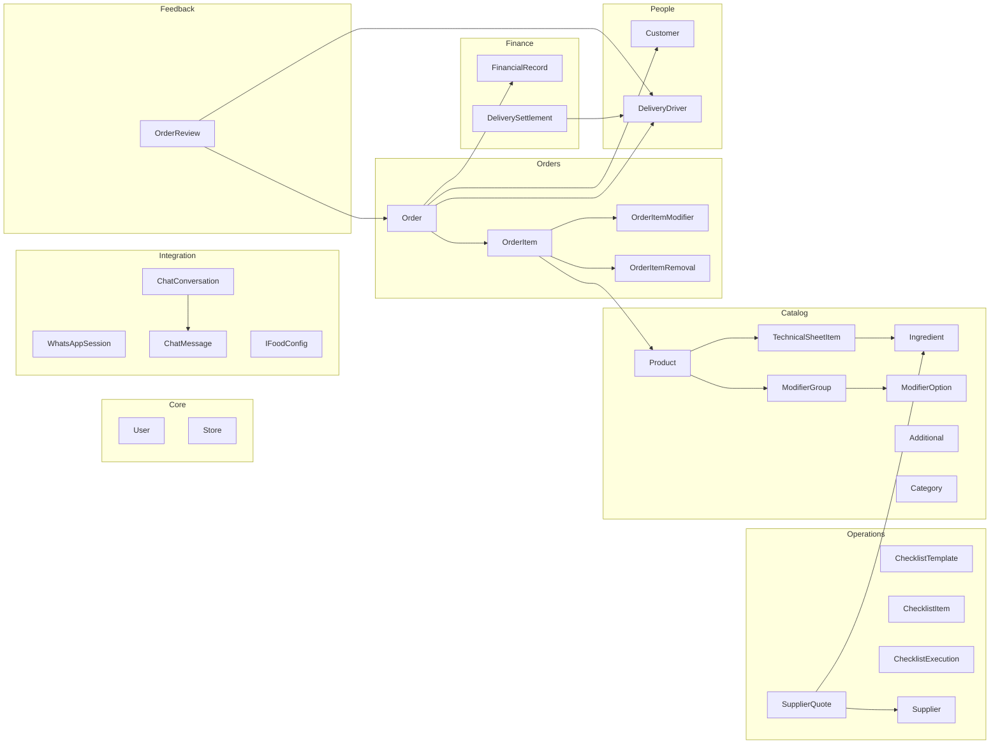
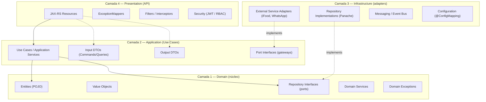

# BiteFlow — Especificação Técnica da API Backend

> **Documento de Referência Definitivo** para o desenvolvimento da API REST que alimentará o sistema de gestão de restaurantes e lanchonetes **BiteFlow**.
>
> Gerado por engenharia reversa do workspace frontend (Vue 3 + Vite + Pinia).

---

## Índice

1. [Visão Geral do Domínio Extraído](#1-visão-geral-do-domínio-extraído)
2. [Visão Geral da Arquitetura](#2-visão-geral-da-arquitetura)
3. [Estrutura de Pacotes (Tree)](#3-estrutura-de-pacotes-tree)
4. [Modelagem de Dados (MER)](#4-modelagem-de-dados-mer)
5. [Mapeamento de Rotas (API REST)](#5-mapeamento-de-rotas-api-rest)
6. [Cross-Cutting Concerns](#6-cross-cutting-concerns)
7. [Stack Tecnológica e Boas Práticas](#7-stack-tecnológica-e-boas-práticas)

---

## 1. Visão Geral do Domínio Extraído

A análise dos arquivos do frontend revelou **11 módulos de negócio** e **20+ entidades**. Abaixo, o mapeamento entre cada módulo funcional do frontend e as entidades de domínio inferidas.

### 1.1 Módulos Identificados

| # | Módulo | Fonte no Front | Descrição |
|---|--------|----------------|-----------|
| 1 | **Autenticação & Autorização** | `auth.js`, `Login.vue`, `Usuarios.vue`, `CadastroUsuario.vue` | Login, gestão de usuários, roles (`admin`, `gerente`, `caixa`) e permissões granulares por módulo. |
| 2 | **Pedidos** | `ControlePedidos.vue`, `NovoPedido.vue`, `ItemCustomizationModal.vue`, `OrderSummarySidebar.vue`, `OrderConfirmationModal.vue`, `ChatDrawer.vue` | Ciclo completo do pedido: criação (POS) e **edição** de pedidos existentes, customização de itens (modificadores, remoções, **quantidade e observação**), Kanban de status (Análise → Preparo → Em Rota → Finalizado), atribuição de motoboy, polling iFood, **emissão de NF-e** e **widget flutuante de chat** (WhatsApp/iFood) integrado diretamente na tela de pedidos. |
| 3 | **Clientes** | `ListaClientes.vue`, `CadastroCliente.vue` | CRUD de clientes com nome, telefone, e-mail, endereço estruturado e total de pedidos. |
| 4 | **Produtos (Cardápio)** | `ListaProdutos.vue`, `CadastroProduto.vue` | CRUD de produtos com categoria, preço de venda, imagem, ficha técnica (composição de ingredientes), itens removíveis e vínculo com grupos de modificadores. |
| 5 | **Ingredientes (Insumos)** | `ListaIngredientes.vue`, `CadastroIngrediente.vue` | CRUD de ingredientes com estoque, unidade de medida (`un`, `kg`, `lt`, `gr`), custo unitário e alerta de estoque mínimo. |
| 6 | **Entregadores** | `ListaEntregadores.vue`, `CadastroEntregador.vue`, `AcertoEntregadores.vue` | CRUD de entregadores com tipo (Fixo/Diarista), ajuda de custo, valor fixo por entrega, status, rating. Relatório de acerto (settlement) por período. |
| 7 | **Financeiro** | `Financeiro.vue`, `CMV.vue` | Relatórios de faturamento bruto, vendas por produto, formas de pagamento. Controle de CMV geral e por produto. |
| 8 | **Integrações** | `Integracoes.vue`, `ChatDrawer.vue` | Integração com WhatsApp (QR Code, connect/disconnect) e iFood (OAuth, abrir/fechar loja, polling de pedidos, sync de status). Chat com clientes via drawer lateral (acessível pelo widget flutuante na tela de pedidos). **Nota:** A `CentralMensagens.vue` foi removida — o chat agora é acessado exclusivamente pelo botão flutuante no Kanban de pedidos. |
| 9 | **Configurações de Modificadores** | `ConfiguracaoModificadores.vue` | Grupos de modificadores (radio/checkbox, obrigatório/opcional, min/max seleções), catálogo de adicionais globais, configuração de itens removíveis por produto. |
| 10 | **Operacional** | `Checklist.vue`, `Cotacoes.vue` | Checklist diário de abertura/fechamento. Cotações e compras de insumos com fornecedores. |
| 11 | **Cardápio Digital** | `CardapioDigital.vue` | Tela pública acessível por `/:storeName` para clientes visualizarem o cardápio e fazerem pedidos. |
| 12 | **Avaliação de Pedidos** | `AvaliacaoPedido.vue`, `StarRating.vue` | Tela pública acessível por `/avaliar/:orderId` para o cliente avaliar atendimento, comida, tempo, embalagem e nota geral. |
| 13 | **Dashboard** | `Dashboard.vue` | Painel resumo com KPIs (vendas do dia, novos clientes, pedidos ativos, ticket médio), pedidos recentes e equipe de entrega. |

### 1.2 Entidades de Domínio



---

## 2. Visão Geral da Arquitetura

### 2.1 Clean Architecture com Quarkus

A arquitetura segue o modelo de **Clean Architecture** com 4 camadas concêntricas, onde o Quarkus é confinado às bordas (Infrastructure e Presentation). As regras de negócio (Entities e Use Cases) são **POJO puro** sem dependência de frameworks.



### 2.2 Princípios Fundamentais

| Princípio | Aplicação |
|-----------|-----------|
| **SRP** | Cada Use Case tem uma única responsabilidade (ex: `CreateOrderUseCase`, `AdvanceOrderStatusUseCase`). |
| **OCP** | Novas integrações (ex: Rappi) são adicionadas implementando a interface `ExternalOrderGateway` sem alterar o core. |
| **LSP** | Repository implementations são intercambiáveis (Panache hoje, JOOQ amanhã). |
| **ISP** | Interfaces de Repository segregadas por Aggregate Root. Não existe um "SuperRepository". |
| **DIP** | Use Cases dependem de interfaces (`OrderRepository`), nunca de implementações concretas (`PanacheOrderRepository`). |
| **DDD** | Agregados (Order + OrderItems), Value Objects (Address, Money), Domain Events (OrderCreatedEvent). |

### 2.3 Fluxo de uma Requisição

```
HTTP Request
  → JAX-RS Resource (valida input, converte DTO)
    → Use Case (orquestra regras de negócio)
      → Domain Entity (aplica invariantes)
      → Repository Interface (persiste via port)
    ← Output DTO
  ← HTTP Response (JSON)
```

---

## 3. Estrutura de Pacotes (Tree)

```
com.biteflow/
├── BiteFlowApplication.java                     # Classe principal Quarkus
│
├── domain/                                       # ═══ CAMADA 1: DOMÍNIO ═══
│   │
│   ├── auth/
│   │   ├── entity/
│   │   │   └── User.java                        # id, name, login, passwordHash, role, permissions[]
│   │   ├── valueobject/
│   │   │   ├── Role.java                        # Enum: ADMIN, GERENTE, CAIXA
│   │   │   └── Permission.java                  # Enum: DASHBOARD, PEDIDOS, CLIENTES, etc.
│   │   ├── repository/
│   │   │   └── UserRepository.java              # Interface (port)
│   │   └── exception/
│   │       ├── InvalidCredentialsException.java
│   │       └── UserAlreadyExistsException.java
│   │
│   ├── customer/
│   │   ├── entity/
│   │   │   └── Customer.java                    # id, name, phone, email, address (VO), totalOrders
│   │   ├── valueobject/
│   │   │   └── Address.java                     # zipCode, street, number, complement, neighborhood
│   │   ├── repository/
│   │   │   └── CustomerRepository.java
│   │   └── exception/
│   │       └── CustomerNotFoundException.java
│   │
│   ├── catalog/
│   │   ├── entity/
│   │   │   ├── Product.java                     # id, name, category, description, price, imageUrl, stock, technicalSheet[], removableItemIds[], modifierGroupIds[]
│   │   │   ├── Ingredient.java                  # id, name, stock, unit, costPrice, minStock
│   │   │   ├── TechnicalSheetItem.java          # ingredientId, name, unit, cost, quantity
│   │   │   ├── ModifierGroup.java               # id, name, type(radio/checkbox), required, min/maxSelections, icon, options[]
│   │   │   ├── ModifierOption.java              # id, name, price
│   │   │   └── Additional.java                  # id, name, price, category, active
│   │   ├── valueobject/
│   │   │   ├── UnitOfMeasure.java               # Enum: UN, KG, LT, GR
│   │   │   ├── ModifierType.java                # Enum: RADIO, CHECKBOX
│   │   │   └── ProductCategory.java             # String ou Enum dinâmico
│   │   ├── repository/
│   │   │   ├── ProductRepository.java
│   │   │   ├── IngredientRepository.java
│   │   │   ├── ModifierGroupRepository.java
│   │   │   └── AdditionalRepository.java
│   │   └── exception/
│   │       ├── ProductNotFoundException.java
│   │       ├── IngredientNotFoundException.java
│   │       └── InsufficientStockException.java
│   │
│   ├── order/
│   │   ├── entity/
│   │   │   ├── Order.java                       # id, customerId, customerName, items[], type, status, paymentMethod, driverId, driverName, platform, externalOrderId, totalValue, deliveryCost, nfeEmitted, createdAt
│   │   │   ├── OrderItem.java                   # id, productId, productName, quantity, unitPrice, extraPrice, totalPrice, modifiers[], removals[], observation
│   │   │   ├── OrderItemModifier.java           # groupId, groupName, optionId, optionName, price
│   │   │   └── OrderItemRemoval.java            # ingredientId, ingredientName
│   │   ├── valueobject/
│   │   │   ├── OrderStatus.java                 # Enum: ANALISE, PREPARO, EM_ROTA, FINALIZADO, CANCELADO
│   │   │   ├── OrderType.java                   # Enum: BALCAO, DELIVERY
│   │   │   ├── PaymentMethod.java               # Enum: PIX, CREDITO, DEBITO, DINHEIRO
│   │   │   └── OrderPlatform.java               # Enum: OWN, IFOOD, WHATSAPP
│   │   ├── repository/
│   │   │   └── OrderRepository.java
│   │   ├── service/
│   │   │   └── OrderDomainService.java          # Regras de transição de status, validações de negócio
│   │   └── exception/
│   │       ├── OrderNotFoundException.java
│   │       └── InvalidOrderTransitionException.java
│   │
│   ├── delivery/
│   │   ├── entity/
│   │   │   ├── DeliveryDriver.java              # id, name, phone, status, isFixed, isDaily, allowance, hasFixedDeliveryValue, fixedDeliveryValue, totalDeliveries, rating
│   │   │   └── DeliverySettlement.java           # id, driverId, period, deliveries, allowance, feePerDelivery, total, settledAt
│   │   ├── valueobject/
│   │   │   ├── DriverStatus.java                # Enum: ATIVO, INATIVO
│   │   │   ├── DriverType.java                  # Enum: FIXO, DIARISTA
│   │   │   └── SettlementPeriod.java            # Enum: DAILY, WEEKLY, MONTHLY
│   │   ├── repository/
│   │   │   ├── DeliveryDriverRepository.java
│   │   │   └── DeliverySettlementRepository.java
│   │   └── exception/
│   │       └── DriverNotFoundException.java
│   │
│   ├── financial/
│   │   ├── entity/
│   │   │   └── FinancialRecord.java             # id, orderId, date, time, totalValue, paymentMethod, status, products[]
│   │   ├── valueobject/
│   │   │   └── FinancialStatus.java             # Enum: CONCLUIDO, CANCELADO, ESTORNADO
│   │   ├── repository/
│   │   │   └── FinancialRecordRepository.java
│   │   └── exception/
│   │       └── FinancialRecordNotFoundException.java
│   │
│   ├── review/
│   │   ├── entity/
│   │   │   └── OrderReview.java                 # id, orderId, driverName, ratings{atendimento, comida, tempo, embalagem, geral}, comment, createdAt
│   │   ├── repository/
│   │   │   └── OrderReviewRepository.java
│   │   └── exception/
│   │       └── ReviewAlreadyExistsException.java
│   │
│   ├── integration/
│   │   ├── entity/
│   │   │   ├── WhatsAppSession.java             # id, storeId, status, qrCode, connectedAt
│   │   │   ├── IFoodConfig.java                 # id, storeId, clientId, clientSecret, merchantId, status, storeStatus
│   │   │   ├── ChatConversation.java            # id, customerName, platform, lastMessage, lastMessageTime, messages[]
│   │   │   └── ChatMessage.java                 # id, conversationId, sender, text, sentAt
│   │   ├── valueobject/
│   │   │   ├── IntegrationStatus.java           # Enum: CONNECTED, DISCONNECTED, PENDING_QR
│   │   │   ├── IFoodStoreStatus.java            # Enum: OPEN, CLOSED
│   │   │   └── ChatPlatform.java                # Enum: WHATSAPP, IFOOD
│   │   ├── gateway/
│   │   │   ├── WhatsAppGateway.java             # Interface para integração externa
│   │   │   └── IFoodGateway.java                # Interface para integração externa
│   │   └── repository/
│   │       ├── ChatConversationRepository.java
│   │       └── IntegrationConfigRepository.java
│   │
│   ├── operational/
│   │   ├── entity/
│   │   │   ├── ChecklistTemplate.java           # id, type(ABERTURA/FECHAMENTO), items[]
│   │   │   ├── ChecklistItem.java               # id, task, description, order
│   │   │   ├── ChecklistExecution.java          # id, templateId, executedBy, executedAt, completedItems[]
│   │   │   ├── Supplier.java                    # id, name, contact, address
│   │   │   └── SupplierQuote.java               # id, ingredientId, supplierId, price, quotedAt
│   │   ├── repository/
│   │   │   ├── ChecklistRepository.java
│   │   │   └── SupplierQuoteRepository.java
│   │   └── valueobject/
│   │       └── ChecklistType.java               # Enum: ABERTURA, FECHAMENTO
│   │
│   └── store/
│       ├── entity/
│       │   └── Store.java                       # id, name, logoUrl, isOpen, openingHours, address
│       └── repository/
│           └── StoreRepository.java
│
├── application/                                  # ═══ CAMADA 2: USE CASES ═══
│   │
│   ├── auth/
│   │   ├── LoginUseCase.java
│   │   ├── CreateUserUseCase.java
│   │   ├── UpdateUserUseCase.java
│   │   ├── DeleteUserUseCase.java
│   │   ├── ListUsersUseCase.java
│   │   ├── dto/
│   │   │   ├── LoginRequest.java
│   │   │   ├── LoginResponse.java               # token, user { id, name, role, permissions[] }
│   │   │   ├── CreateUserRequest.java
│   │   │   ├── UpdateUserRequest.java
│   │   │   └── UserResponse.java
│   │   └── port/
│   │       └── TokenProvider.java               # Interface para gerar/validar JWT
│   │
│   ├── customer/
│   │   ├── CreateCustomerUseCase.java
│   │   ├── UpdateCustomerUseCase.java
│   │   ├── DeleteCustomerUseCase.java
│   │   ├── ListCustomersUseCase.java
│   │   ├── GetCustomerUseCase.java
│   │   └── dto/
│   │       ├── CustomerRequest.java
│   │       ├── CustomerResponse.java
│   │       └── CustomerListResponse.java
│   │
│   ├── catalog/
│   │   ├── product/
│   │   │   ├── CreateProductUseCase.java
│   │   │   ├── UpdateProductUseCase.java
│   │   │   ├── DeleteProductUseCase.java
│   │   │   ├── ListProductsUseCase.java
│   │   │   ├── GetProductUseCase.java
│   │   │   └── dto/
│   │   │       ├── ProductRequest.java
│   │   │       ├── ProductResponse.java
│   │   │       └── TechnicalSheetItemDto.java
│   │   ├── ingredient/
│   │   │   ├── CreateIngredientUseCase.java
│   │   │   ├── UpdateIngredientUseCase.java
│   │   │   ├── DeleteIngredientUseCase.java
│   │   │   ├── ListIngredientsUseCase.java
│   │   │   ├── GetIngredientUseCase.java
│   │   │   └── dto/
│   │   │       ├── IngredientRequest.java
│   │   │       └── IngredientResponse.java
│   │   ├── modifier/
│   │   │   ├── CreateModifierGroupUseCase.java
│   │   │   ├── UpdateModifierGroupUseCase.java
│   │   │   ├── DeleteModifierGroupUseCase.java
│   │   │   ├── ListModifierGroupsUseCase.java
│   │   │   └── dto/
│   │   │       ├── ModifierGroupRequest.java
│   │   │       ├── ModifierGroupResponse.java
│   │   │       └── ModifierOptionDto.java
│   │   └── additional/
│   │       ├── CreateAdditionalUseCase.java
│   │       ├── UpdateAdditionalUseCase.java
│   │       ├── DeleteAdditionalUseCase.java
│   │       ├── ListAdditionalsUseCase.java
│   │       ├── ToggleAdditionalStatusUseCase.java
│   │       └── dto/
│   │           ├── AdditionalRequest.java
│   │           └── AdditionalResponse.java
│   │
│   ├── order/
│   │   ├── CreateOrderUseCase.java
│   │   ├── UpdateOrderUseCase.java                # Edição de pedidos existentes
│   │   ├── AdvanceOrderStatusUseCase.java
│   │   ├── AssignDriverUseCase.java
│   │   ├── ListOrdersKanbanUseCase.java
│   │   ├── DeleteOrderUseCase.java
│   │   ├── MoveOrderToColumnUseCase.java
│   │   ├── EmitNfeUseCase.java                    # Emissão de NF-e
│   │   └── dto/
│   │       ├── CreateOrderRequest.java
│   │       ├── UpdateOrderRequest.java
│   │       ├── CreateOrderItemDto.java           # Inclui quantity e observation
│   │       ├── OrderKanbanResponse.java
│   │       ├── OrderResponse.java
│   │       ├── AssignDriverRequest.java
│   │       ├── MoveOrderRequest.java
│   │       └── NfeResponse.java
│   │
│   ├── delivery/
│   │   ├── CreateDriverUseCase.java
│   │   ├── UpdateDriverUseCase.java
│   │   ├── DeleteDriverUseCase.java
│   │   ├── ListDriversUseCase.java
│   │   ├── GetDriverUseCase.java
│   │   ├── GetSettlementReportUseCase.java
│   │   └── dto/
│   │       ├── DriverRequest.java
│   │       ├── DriverResponse.java
│   │       └── SettlementReportResponse.java
│   │
│   ├── financial/
│   │   ├── GetSalesSummaryUseCase.java
│   │   ├── GetSalesByProductUseCase.java
│   │   ├── GetPaymentMethodsReportUseCase.java
│   │   ├── CalculateGeneralCmvUseCase.java
│   │   ├── CalculateProductCmvUseCase.java
│   │   └── dto/
│   │       ├── SalesSummaryResponse.java
│   │       ├── SalesByProductResponse.java
│   │       ├── PaymentMethodReportResponse.java
│   │       ├── GeneralCmvRequest.java
│   │       ├── GeneralCmvResponse.java
│   │       └── ProductCmvResponse.java
│   │
│   ├── review/
│   │   ├── SubmitOrderReviewUseCase.java
│   │   ├── GetOrderReviewUseCase.java
│   │   └── dto/
│   │       ├── SubmitReviewRequest.java
│   │       └── ReviewResponse.java
│   │
│   ├── integration/
│   │   ├── whatsapp/
│   │   │   ├── ConnectWhatsAppUseCase.java
│   │   │   ├── DisconnectWhatsAppUseCase.java
│   │   │   ├── GetWhatsAppStatusUseCase.java
│   │   │   └── dto/
│   │   │       ├── WhatsAppQrResponse.java
│   │   │       └── WhatsAppStatusResponse.java
│   │   ├── ifood/
│   │   │   ├── AuthorizeIFoodUseCase.java
│   │   │   ├── ToggleIFoodStoreUseCase.java
│   │   │   ├── PollIFoodOrdersUseCase.java
│   │   │   ├── SyncIFoodStatusUseCase.java
│   │   │   └── dto/
│   │   │       ├── IFoodAuthRequest.java
│   │   │       ├── IFoodStatusResponse.java
│   │   │       └── IFoodOrderResponse.java
│   │   └── chat/
│   │       ├── ListConversationsUseCase.java
│   │       ├── GetConversationUseCase.java
│   │       ├── SendMessageUseCase.java
│   │       └── dto/
│   │           ├── ConversationResponse.java
│   │           ├── MessageResponse.java
│   │           └── SendMessageRequest.java
│   │
│   ├── operational/
│   │   ├── GetChecklistUseCase.java
│   │   ├── SaveChecklistExecutionUseCase.java
│   │   ├── ListQuotesUseCase.java
│   │   ├── CreateQuoteUseCase.java
│   │   └── dto/
│   │       ├── ChecklistResponse.java
│   │       ├── ChecklistExecutionRequest.java
│   │       ├── QuoteResponse.java
│   │       └── QuoteRequest.java
│   │
│   ├── store/
│   │   ├── GetStoreInfoUseCase.java
│   │   ├── UpdateStoreInfoUseCase.java
│   │   └── dto/
│   │       ├── StoreInfoResponse.java
│   │       └── StoreInfoRequest.java
│   │
│   └── dashboard/
│       ├── GetDashboardUseCase.java
│       └── dto/
│           └── DashboardResponse.java
│
├── infrastructure/                               # ═══ CAMADA 3: INFRAESTRUTURA ═══
│   │
│   ├── persistence/
│   │   ├── panache/
│   │   │   ├── entity/                          # JPA Entities (mapeamento @Entity)
│   │   │   │   ├── UserEntity.java
│   │   │   │   ├── CustomerEntity.java
│   │   │   │   ├── ProductEntity.java
│   │   │   │   ├── IngredientEntity.java
│   │   │   │   ├── TechnicalSheetItemEntity.java
│   │   │   │   ├── ModifierGroupEntity.java
│   │   │   │   ├── ModifierOptionEntity.java
│   │   │   │   ├── AdditionalEntity.java
│   │   │   │   ├── OrderEntity.java
│   │   │   │   ├── OrderItemEntity.java
│   │   │   │   ├── OrderItemModifierEntity.java
│   │   │   │   ├── OrderItemRemovalEntity.java
│   │   │   │   ├── DeliveryDriverEntity.java
│   │   │   │   ├── DeliverySettlementEntity.java
│   │   │   │   ├── FinancialRecordEntity.java
│   │   │   │   ├── OrderReviewEntity.java
│   │   │   │   ├── StoreEntity.java
│   │   │   │   ├── ChatConversationEntity.java
│   │   │   │   ├── ChatMessageEntity.java
│   │   │   │   ├── ChecklistTemplateEntity.java
│   │   │   │   ├── ChecklistItemEntity.java
│   │   │   │   ├── ChecklistExecutionEntity.java
│   │   │   │   ├── SupplierEntity.java
│   │   │   │   ├── SupplierQuoteEntity.java
│   │   │   │   ├── WhatsAppSessionEntity.java
│   │   │   │   └── IFoodConfigEntity.java
│   │   │   ├── repository/                      # Implementações Panache dos ports
│   │   │   │   ├── PanacheUserRepository.java
│   │   │   │   ├── PanacheCustomerRepository.java
│   │   │   │   ├── PanacheProductRepository.java
│   │   │   │   ├── PanacheIngredientRepository.java
│   │   │   │   ├── PanacheModifierGroupRepository.java
│   │   │   │   ├── PanacheAdditionalRepository.java
│   │   │   │   ├── PanacheOrderRepository.java
│   │   │   │   ├── PanacheDeliveryDriverRepository.java
│   │   │   │   ├── PanacheFinancialRecordRepository.java
│   │   │   │   ├── PanacheOrderReviewRepository.java
│   │   │   │   ├── PanacheStoreRepository.java
│   │   │   │   ├── PanacheChatRepository.java
│   │   │   │   ├── PanacheChecklistRepository.java
│   │   │   │   └── PanacheSupplierQuoteRepository.java
│   │   │   └── mapper/                          # Mappers Entity ↔ Domain
│   │   │       ├── UserMapper.java
│   │   │       ├── ProductMapper.java
│   │   │       ├── OrderMapper.java
│   │   │       └── ...
│   │   └── migration/
│   │       └── V1__initial_schema.sql           # Flyway migration
│   │
│   ├── external/
│   │   ├── whatsapp/
│   │   │   └── WhatsAppApiClient.java           # Implementação do WhatsAppGateway
│   │   └── ifood/
│   │       ├── IFoodApiClient.java              # Implementação do IFoodGateway
│   │       └── IFoodWebhookHandler.java         # Recebe eventos do iFood
│   │
│   ├── security/
│   │   ├── JwtTokenProvider.java                # Implementação do TokenProvider
│   │   ├── SecurityConfig.java                  # Configurações de segurança Quarkus
│   │   └── PasswordHasher.java                  # BCrypt hashing
│   │
│   └── config/
│       ├── CorsConfig.java
│       └── AppConfig.java                       # @ConfigMapping para propriedades customizadas
│
└── presentation/                                 # ═══ CAMADA 4: API REST ═══
    │
    ├── rest/
    │   ├── AuthResource.java
    │   ├── UserResource.java
    │   ├── CustomerResource.java
    │   ├── ProductResource.java
    │   ├── IngredientResource.java
    │   ├── ModifierGroupResource.java
    │   ├── AdditionalResource.java
    │   ├── OrderResource.java
    │   ├── DeliveryDriverResource.java
    │   ├── DeliverySettlementResource.java
    │   ├── FinancialResource.java
    │   ├── CmvResource.java
    │   ├── ReviewResource.java
    │   ├── WhatsAppResource.java
    │   ├── IFoodResource.java
    │   ├── ChatResource.java
    │   ├── ChecklistResource.java
    │   ├── QuoteResource.java
    │   ├── StoreResource.java
    │   ├── DashboardResource.java
    │   └── DigitalMenuResource.java
    │
    ├── exception/
    │   ├── GlobalExceptionMapper.java           # @Provider genérico
    │   ├── NotFoundExceptionMapper.java
    │   ├── ValidationExceptionMapper.java
    │   └── ErrorResponse.java                   # { timestamp, status, error, message, path }
    │
    └── filter/
        └── RequestLoggingFilter.java
```

---

## 4. Modelagem de Dados (MER)

### 4.1 Diagrama Entidade-Relacionamento

```mermaid
erDiagram
    STORE {
        UUID id PK
        VARCHAR name
        VARCHAR logo_url
        BOOLEAN is_open
        VARCHAR opening_hours
        VARCHAR address
        TIMESTAMP created_at
        TIMESTAMP updated_at
    }

    USERS {
        UUID id PK
        UUID store_id FK
        VARCHAR name
        VARCHAR login UK
        VARCHAR password_hash
        VARCHAR role
        VARCHAR[] permissions
        BOOLEAN active
        TIMESTAMP created_at
        TIMESTAMP updated_at
    }

    CUSTOMER {
        UUID id PK
        UUID store_id FK
        VARCHAR name
        VARCHAR phone
        VARCHAR email
        VARCHAR zip_code
        VARCHAR address_street
        VARCHAR address_number
        VARCHAR address_complement
        VARCHAR address_neighborhood
        INTEGER total_orders
        TIMESTAMP created_at
        TIMESTAMP updated_at
    }

    INGREDIENT {
        UUID id PK
        UUID store_id FK
        VARCHAR name
        DECIMAL stock
        VARCHAR unit
        DECIMAL cost_price
        DECIMAL min_stock
        TIMESTAMP created_at
        TIMESTAMP updated_at
    }

    PRODUCT {
        UUID id PK
        UUID store_id FK
        VARCHAR name
        VARCHAR category
        VARCHAR description
        DECIMAL price
        VARCHAR image_url
        INTEGER stock
        BOOLEAN active
        TIMESTAMP created_at
        TIMESTAMP updated_at
    }

    TECHNICAL_SHEET_ITEM {
        UUID id PK
        UUID product_id FK
        UUID ingredient_id FK
        DECIMAL quantity
        DECIMAL cost_snapshot
        INTEGER sort_order
    }

    PRODUCT_REMOVABLE_ITEM {
        UUID product_id FK
        UUID ingredient_id FK
    }

    PRODUCT_MODIFIER_GROUP {
        UUID product_id FK
        UUID modifier_group_id FK
    }

    MODIFIER_GROUP {
        UUID id PK
        UUID store_id FK
        VARCHAR name
        VARCHAR type
        BOOLEAN required
        INTEGER min_selections
        INTEGER max_selections
        VARCHAR icon
        TIMESTAMP created_at
        TIMESTAMP updated_at
    }

    MODIFIER_OPTION {
        UUID id PK
        UUID modifier_group_id FK
        VARCHAR name
        DECIMAL price
        INTEGER sort_order
    }

    ADDITIONAL {
        UUID id PK
        UUID store_id FK
        VARCHAR name
        DECIMAL price
        VARCHAR category
        BOOLEAN active
        TIMESTAMP created_at
        TIMESTAMP updated_at
    }

    ORDERS {
        UUID id PK
        UUID store_id FK
        VARCHAR display_id
        UUID customer_id FK
        VARCHAR customer_name
        VARCHAR customer_address
        VARCHAR type
        VARCHAR status
        VARCHAR payment_method
        UUID driver_id FK
        VARCHAR driver_name
        VARCHAR platform
        VARCHAR external_order_id
        DECIMAL subtotal
        DECIMAL delivery_cost
        DECIMAL total_value
        TIMESTAMP created_at
        TIMESTAMP updated_at
        TIMESTAMP finished_at
    }

    ORDER_ITEM {
        UUID id PK
        UUID order_id FK
        UUID product_id FK
        VARCHAR product_name
        INTEGER quantity
        DECIMAL unit_price
        DECIMAL extra_price
        DECIMAL total_price
        VARCHAR observation
    }

    ORDER_ITEM_MODIFIER {
        UUID id PK
        UUID order_item_id FK
        UUID modifier_group_id FK
        VARCHAR group_name
        UUID modifier_option_id FK
        VARCHAR option_name
        DECIMAL price
    }

    ORDER_ITEM_REMOVAL {
        UUID id PK
        UUID order_item_id FK
        UUID ingredient_id FK
        VARCHAR ingredient_name
    }

    DELIVERY_DRIVER {
        UUID id PK
        UUID store_id FK
        VARCHAR name
        VARCHAR phone
        VARCHAR status
        BOOLEAN is_fixed
        BOOLEAN is_daily
        DECIMAL allowance
        BOOLEAN has_fixed_delivery_value
        DECIMAL fixed_delivery_value
        INTEGER total_deliveries
        DECIMAL rating
        TIMESTAMP created_at
        TIMESTAMP updated_at
    }

    FINANCIAL_RECORD {
        UUID id PK
        UUID store_id FK
        UUID order_id FK
        DATE record_date
        TIME record_time
        DECIMAL total_value
        VARCHAR payment_method
        VARCHAR status
        TIMESTAMP created_at
    }

    FINANCIAL_RECORD_PRODUCT {
        UUID id PK
        UUID financial_record_id FK
        UUID product_id FK
        VARCHAR product_name
        INTEGER quantity
        DECIMAL price
    }

    ORDER_REVIEW {
        UUID id PK
        UUID order_id FK
        UUID driver_id FK
        VARCHAR driver_name
        INTEGER rating_atendimento
        INTEGER rating_comida
        INTEGER rating_tempo
        INTEGER rating_embalagem
        INTEGER rating_geral
        TEXT comment
        TIMESTAMP created_at
    }

    WHATSAPP_SESSION {
        UUID id PK
        UUID store_id FK
        VARCHAR status
        VARCHAR qr_code
        TIMESTAMP connected_at
        TIMESTAMP updated_at
    }

    IFOOD_CONFIG {
        UUID id PK
        UUID store_id FK
        VARCHAR client_id
        VARCHAR client_secret_encrypted
        VARCHAR merchant_id
        VARCHAR status
        VARCHAR store_status
        TIMESTAMP connected_at
        TIMESTAMP updated_at
    }

    CHAT_CONVERSATION {
        UUID id PK
        UUID store_id FK
        VARCHAR customer_name
        VARCHAR platform
        VARCHAR last_message
        TIMESTAMP last_message_at
        TIMESTAMP created_at
    }

    CHAT_MESSAGE {
        UUID id PK
        UUID conversation_id FK
        VARCHAR sender
        TEXT text_content
        TIMESTAMP sent_at
    }

    CHECKLIST_TEMPLATE {
        UUID id PK
        UUID store_id FK
        VARCHAR type
    }

    CHECKLIST_ITEM {
        UUID id PK
        UUID template_id FK
        VARCHAR task
        VARCHAR description
        INTEGER sort_order
    }

    CHECKLIST_EXECUTION {
        UUID id PK
        UUID template_id FK
        UUID executed_by FK
        DATE execution_date
        UUID[] completed_item_ids
        TIMESTAMP executed_at
    }

    SUPPLIER {
        UUID id PK
        UUID store_id FK
        VARCHAR name
        VARCHAR contact
        VARCHAR address
    }

    SUPPLIER_QUOTE {
        UUID id PK
        UUID ingredient_id FK
        UUID supplier_id FK
        DECIMAL price
        DATE quoted_at
    }

    %% Relationships
    STORE ||--o{ USERS : "has"
    STORE ||--o{ CUSTOMER : "has"
    STORE ||--o{ PRODUCT : "has"
    STORE ||--o{ INGREDIENT : "has"
    STORE ||--o{ MODIFIER_GROUP : "has"
    STORE ||--o{ ADDITIONAL : "has"
    STORE ||--o{ ORDERS : "has"
    STORE ||--o{ DELIVERY_DRIVER : "has"
    STORE ||--|| WHATSAPP_SESSION : "has"
    STORE ||--|| IFOOD_CONFIG : "has"

    PRODUCT ||--o{ TECHNICAL_SHEET_ITEM : "composed of"
    INGREDIENT ||--o{ TECHNICAL_SHEET_ITEM : "used in"
    PRODUCT ||--o{ PRODUCT_REMOVABLE_ITEM : "allows removal"
    INGREDIENT ||--o{ PRODUCT_REMOVABLE_ITEM : "removable from"
    PRODUCT ||--o{ PRODUCT_MODIFIER_GROUP : "linked to"
    MODIFIER_GROUP ||--o{ PRODUCT_MODIFIER_GROUP : "linked to"
    MODIFIER_GROUP ||--o{ MODIFIER_OPTION : "has"

    ORDERS ||--o{ ORDER_ITEM : "contains"
    ORDER_ITEM ||--o{ ORDER_ITEM_MODIFIER : "customized with"
    ORDER_ITEM ||--o{ ORDER_ITEM_REMOVAL : "removed items"
    CUSTOMER ||--o{ ORDERS : "places"
    DELIVERY_DRIVER ||--o{ ORDERS : "delivers"

    ORDERS ||--|| FINANCIAL_RECORD : "generates"
    FINANCIAL_RECORD ||--o{ FINANCIAL_RECORD_PRODUCT : "details"

    ORDERS ||--o| ORDER_REVIEW : "reviewed by"
    DELIVERY_DRIVER ||--o{ ORDER_REVIEW : "reviewed in"

    CHAT_CONVERSATION ||--o{ CHAT_MESSAGE : "has"

    CHECKLIST_TEMPLATE ||--o{ CHECKLIST_ITEM : "contains"
    CHECKLIST_TEMPLATE ||--o{ CHECKLIST_EXECUTION : "executed as"

    SUPPLIER ||--o{ SUPPLIER_QUOTE : "quotes"
    INGREDIENT ||--o{ SUPPLIER_QUOTE : "quoted for"
```



### 4.2 Notas sobre a Modelagem

> [!IMPORTANT]
> - **Multi-tenancy**: Todas as tabelas possuem `store_id` (FK para `STORE`) para suportar múltiplos estabelecimentos.
> - **Soft Delete**: Considerar `deleted_at` em entidades como `Product`, `Ingredient`, `Customer` para manter histórico.
> - **Audit Trail**: `created_at` e `updated_at` em todas as tabelas gerenciados por `@PrePersist` / `@PreUpdate`.
> - **UUIDs**: Todas as PKs são `UUID` para segurança e distribuição.
> - **Snapshots**: `ORDER_ITEM` armazena `product_name` e `unit_price` como snapshot, pois o produto pode mudar depois.
> - **Permissions**: Armazenadas como `VARCHAR[]` (array PostgreSQL nativo) para flexibilidade.

---

## 5. Mapeamento de Rotas (API REST)

> **Convenção de base path**: `/api/v1`
>
> **Autenticação**: Todas as rotas (exceto públicas) requerem header `Authorization: Bearer <JWT>`.
>
> **Rotas públicas**: Marcadas com 🌐.

---

### 5.1 Autenticação (`/api/v1/auth`)

| Método | Rota | Descrição | Permissão | Request Body | Response Body |
|--------|------|-----------|-----------|--------------|---------------|
| `POST` | `/auth/login` | Autenticar usuário | 🌐 Pública | `LoginRequest` | `LoginResponse` |
| `POST` | `/auth/logout` | Invalidar token | Autenticado | — | `204 No Content` |
| `GET` | `/auth/me` | Dados do usuário logado | Autenticado | — | `UserResponse` |

**`LoginRequest`**:
```json
{
  "login": "admin",
  "password": "admin123"
}
```

**`LoginResponse`**:
```json
{
  "token": "eyJhbGciOiJSUzI1NiIs...",
  "expiresIn": 86400,
  "user": {
    "id": "uuid",
    "name": "Administrador",
    "login": "admin",
    "role": "ADMIN",
    "permissions": ["dashboard", "pedidos", "clientes", "ingredientes", "produtos", "entregadores", "acerto_entregadores", "usuarios", "integracoes", "financeiro"]
  }
}
```

---

### 5.2 Usuários (`/api/v1/users`)

| Método | Rota | Descrição | Permissão |
|--------|------|-----------|-----------|
| `GET` | `/users` | Listar todos os usuários | `usuarios` |
| `GET` | `/users/{id}` | Obter usuário por ID | `usuarios` |
| `POST` | `/users` | Criar novo usuário | `usuarios` |
| `PUT` | `/users/{id}` | Atualizar usuário | `usuarios` |
| `DELETE` | `/users/{id}` | Remover usuário | `usuarios` |

**`CreateUserRequest` / `UpdateUserRequest`**:
```json
{
  "name": "Gerente da Loja",
  "login": "gerente",
  "password": "gerente123",
  "role": "GERENTE",
  "permissions": ["pedidos", "clientes", "ingredientes", "produtos", "entregadores", "acerto_entregadores"]
}
```

**`UserResponse`**:
```json
{
  "id": "uuid",
  "name": "Gerente da Loja",
  "login": "gerente",
  "role": "GERENTE",
  "permissions": ["pedidos", "clientes", "ingredientes", "produtos", "entregadores", "acerto_entregadores"],
  "createdAt": "2026-08-01T10:00:00Z"
}
```

---

### 5.3 Clientes (`/api/v1/customers`)

| Método | Rota | Descrição | Permissão |
|--------|------|-----------|-----------|
| `GET` | `/customers` | Listar clientes (busca por nome/telefone via `?search=`) | `clientes` |
| `GET` | `/customers/{id}` | Obter cliente por ID | `clientes` |
| `POST` | `/customers` | Criar novo cliente | `clientes` |
| `PUT` | `/customers/{id}` | Atualizar cliente | `clientes` |
| `DELETE` | `/customers/{id}` | Remover cliente | `clientes` |

**`CustomerRequest`**:
```json
{
  "name": "Mateus Silva",
  "phone": "(11) 98888-7777",
  "email": "mateus@email.com",
  "zipCode": "01310-100",
  "address": "Rua das Flores",
  "number": "123",
  "complement": "Apto 42",
  "neighborhood": "Centro"
}
```

**`CustomerResponse`**:
```json
{
  "id": "uuid",
  "name": "Mateus Silva",
  "phone": "(11) 98888-7777",
  "email": "mateus@email.com",
  "zipCode": "01310-100",
  "address": "Rua das Flores",
  "number": "123",
  "complement": "Apto 42",
  "neighborhood": "Centro",
  "totalOrders": 15,
  "createdAt": "2026-01-15T10:00:00Z"
}
```

---

### 5.4 Ingredientes (`/api/v1/ingredients`)

| Método | Rota | Descrição | Permissão |
|--------|------|-----------|-----------|
| `GET` | `/ingredients` | Listar ingredientes | `ingredientes` |
| `GET` | `/ingredients/{id}` | Obter ingrediente por ID | `ingredientes` |
| `POST` | `/ingredients` | Criar novo ingrediente | `ingredientes` |
| `PUT` | `/ingredients/{id}` | Atualizar ingrediente | `ingredientes` |
| `DELETE` | `/ingredients/{id}` | Remover ingrediente | `ingredientes` |

**`IngredientRequest`**:
```json
{
  "name": "Pão Brioche",
  "stock": 50.0,
  "unit": "UN",
  "costPrice": 1.50,
  "minStock": 10.0
}
```

**`IngredientResponse`**:
```json
{
  "id": "uuid",
  "name": "Pão Brioche",
  "stock": 50.0,
  "unit": "UN",
  "costPrice": 1.50,
  "minStock": 10.0,
  "createdAt": "2026-01-10T08:00:00Z"
}
```

> [!TIP]
> **Regra de negócio inferida**: Quando o estoque de um ingrediente fica abaixo de `minStock`, o sistema deve gerar um alerta (notification ou flag na resposta da listagem).

---

### 5.5 Produtos (`/api/v1/products`)

| Método | Rota | Descrição | Permissão |
|--------|------|-----------|-----------|
| `GET` | `/products` | Listar produtos (query: `?category=Hambúrgueres`) | `produtos` |
| `GET` | `/products/{id}` | Obter produto completo (com ficha técnica, removíveis e modificadores) | `produtos` |
| `POST` | `/products` | Criar novo produto | `produtos` |
| `PUT` | `/products/{id}` | Atualizar produto | `produtos` |
| `DELETE` | `/products/{id}` | Remover produto | `produtos` |
| `PUT` | `/products/{id}/removable-items` | Configurar itens removíveis | `produtos` |
| `PUT` | `/products/{id}/modifier-groups` | Vincular grupos de modificadores | `produtos` |
| `GET` | `/products/categories` | Listar categorias existentes | `produtos` |

**`ProductRequest`**:
```json
{
  "name": "X-Bacon Especial",
  "category": "Hambúrgueres",
  "description": "Pão brioche, hambúrguer 150g, queijo cheddar, bacon crocante...",
  "price": 35.00,
  "imageUrl": "https://...",
  "stock": 50,
  "technicalSheet": [
    { "ingredientId": "uuid-pao", "quantity": 1 },
    { "ingredientId": "uuid-hamburguer", "quantity": 1 },
    { "ingredientId": "uuid-cheddar", "quantity": 0.020 }
  ],
  "removableItemIds": ["uuid-cheddar", "uuid-bacon", "uuid-alface"],
  "modifierGroupIds": ["uuid-grp-ponto", "uuid-grp-adicionais"]
}
```

**`ProductResponse`**:
```json
{
  "id": "uuid",
  "name": "X-Bacon Especial",
  "category": "Hambúrgueres",
  "description": "Pão brioche, hambúrguer 150g...",
  "price": 35.00,
  "imageUrl": "https://...",
  "stock": 50,
  "technicalSheet": [
    {
      "ingredientId": "uuid-pao",
      "name": "Pão Brioche",
      "unit": "UN",
      "cost": 1.50,
      "quantity": 1
    }
  ],
  "removableItems": [
    { "ingredientId": "uuid-cheddar", "name": "Queijo Cheddar" }
  ],
  "modifierGroupIds": ["uuid-grp-ponto", "uuid-grp-adicionais"],
  "totalCost": 8.40,
  "profit": 26.60,
  "createdAt": "2026-01-10T08:00:00Z"
}
```

> [!NOTE]
> **Regra de negócio**: `totalCost` é calculado pelo backend somando `ingrediente.costPrice × technicalSheetItem.quantity`. `profit = price - totalCost`.

---

### 5.6 Grupos de Modificadores (`/api/v1/modifier-groups`)

| Método | Rota | Descrição | Permissão |
|--------|------|-----------|-----------|
| `GET` | `/modifier-groups` | Listar todos os grupos | `produtos` |
| `GET` | `/modifier-groups/{id}` | Obter grupo por ID | `produtos` |
| `POST` | `/modifier-groups` | Criar grupo | `produtos` |
| `PUT` | `/modifier-groups/{id}` | Atualizar grupo | `produtos` |
| `DELETE` | `/modifier-groups/{id}` | Excluir grupo (desvincula de produtos) | `produtos` |

**`ModifierGroupRequest`**:
```json
{
  "name": "Ponto da Carne",
  "type": "RADIO",
  "required": true,
  "minSelections": 1,
  "maxSelections": 1,
  "icon": "🥩",
  "options": [
    { "name": "Mal Passado", "price": 0 },
    { "name": "Ao Ponto", "price": 0 },
    { "name": "Bem Passado", "price": 0 }
  ]
}
```

**`ModifierGroupResponse`**:
```json
{
  "id": "uuid",
  "name": "Ponto da Carne",
  "type": "RADIO",
  "required": true,
  "minSelections": 1,
  "maxSelections": 1,
  "icon": "🥩",
  "options": [
    { "id": "uuid-opt", "name": "Mal Passado", "price": 0 },
    { "id": "uuid-opt", "name": "Ao Ponto", "price": 0 },
    { "id": "uuid-opt", "name": "Bem Passado", "price": 0 }
  ]
}
```

---

### 5.7 Adicionais Globais (`/api/v1/additionals`)

| Método | Rota | Descrição | Permissão |
|--------|------|-----------|-----------|
| `GET` | `/additionals` | Listar adicionais | `produtos` |
| `POST` | `/additionals` | Criar adicional | `produtos` |
| `PUT` | `/additionals/{id}` | Atualizar adicional | `produtos` |
| `PATCH` | `/additionals/{id}/toggle-status` | Ativar/desativar adicional | `produtos` |
| `DELETE` | `/additionals/{id}` | Excluir adicional | `produtos` |

**`AdditionalRequest`**:
```json
{
  "name": "Queijo Coalho",
  "price": 5.00,
  "category": "Queijos"
}
```

**`AdditionalResponse`**:
```json
{
  "id": "uuid",
  "name": "Queijo Coalho",
  "price": 5.00,
  "category": "Queijos",
  "active": true
}
```

---

### 5.8 Pedidos (`/api/v1/orders`)

| Método | Rota | Descrição | Permissão |
|--------|------|-----------|-----------|
| `GET` | `/orders/kanban` | Listar pedidos agrupados por status (Kanban) com filtros `?type=delivery,balcao` | `pedidos` |
| `GET` | `/orders/{id}` | Obter pedido detalhado | `pedidos` |
| `POST` | `/orders` | Criar novo pedido (POS) | `pedidos` |
| `PUT` | `/orders/{id}` | **Editar pedido existente** (adicionar itens, alterar tipo, pagamento) | `pedidos` |
| `PATCH` | `/orders/{id}/advance` | Avançar status do pedido (Análise→Preparo→Em Rota→Finalizado) | `pedidos` |
| `PATCH` | `/orders/{id}/move` | Mover pedido para coluna específica (drag & drop) | `pedidos` |
| `PATCH` | `/orders/{id}/assign-driver` | Atribuir motoboy ao pedido | `pedidos` |
| `POST` | `/orders/{id}/nfe` | **Emitir NF-e** para o pedido | `pedidos` |
| `PATCH` | `/orders/batch/move` | Mover múltiplos pedidos (ação em massa) | `pedidos` |
| `PATCH` | `/orders/batch/assign-driver` | Atribuir motoboy a múltiplos pedidos | `pedidos` |
| `DELETE` | `/orders/{id}` | Excluir pedido | `pedidos` |

**`CreateOrderRequest`** (criação via POS):
```json
{
  "type": "DELIVERY",
  "customer": {
    "name": "Mateus Silva",
    "address": "Rua das Flores, 123"
  },
  "paymentMethod": "PIX",
  "items": [
    {
      "productId": "uuid-xbacon",
      "quantity": 2,
      "observation": "Capricha no molho",
      "modifiers": [
        { "groupId": "uuid-grp-ponto", "optionId": "uuid-opt-ao-ponto" },
        { "groupId": "uuid-grp-adicionais", "optionId": "uuid-opt-geleia" }
      ],
      "removalIds": ["uuid-alface", "uuid-tomate"]
    }
  ]
}
```

> [!NOTE]
> **Mudança pós-merge**: O campo `quantity` agora é selecionado pelo modal de customização (com botões +/-) e `observation` é um campo de texto livre para instruções especiais (ex: "capricha no molho"). Ambos fazem parte do `CreateOrderItemDto`.

**`UpdateOrderRequest`** (edição de pedido existente):
```json
{
  "type": "DELIVERY",
  "customer": {
    "name": "Mateus Silva",
    "address": "Rua das Flores, 456"
  },
  "paymentMethod": "CREDITO",
  "additionalItems": [
    {
      "productId": "uuid-batata",
      "quantity": 1,
      "observation": "",
      "modifiers": [],
      "removalIds": []
    }
  ]
}
```

> [!IMPORTANT]
> **Regra de edição**: O frontend carrega os itens originais do pedido como um bloco imutável e permite **apenas adicionar novos itens** por cima. O total é recalculado como `totalOriginal + somaNovoItens + taxaEntrega`. O backend deve preservar os itens já registrados e apenas anexar os novos.

**`OrderKanbanResponse`** (resposta do Kanban — **4 colunas**):
```json
{
  "columns": [
    {
      "id": "ANALISE",
      "title": "Pedido em Análise",
      "icon": "Search",
      "orders": [...]
    },
    {
      "id": "PREPARO",
      "title": "Em Preparo",
      "icon": "ChefHat",
      "orders": [...]
    },
    {
      "id": "EM_ROTA",
      "title": "Saiu para Entrega",
      "icon": "Truck",
      "orders": [...]
    },
    {
      "id": "FINALIZADO",
      "title": "Finalizado",
      "icon": "CheckCircle2",
      "orders": [
        {
          "id": "uuid",
          "displayId": "#1026",
          "customerName": "João Silva",
          "itemsSummary": "1x X-Tudo, 1x Suco",
          "elapsedTime": "2 min",
          "totalValue": 45.00,
          "type": "DELIVERY",
          "driverName": null,
          "platform": "OWN",
          "externalOrderId": null,
          "nfeEmitted": false,
          "createdAt": "2026-08-12T15:00:00Z"
        }
      ]
    }
  ]
}
```

**`AssignDriverRequest`**:
```json
{
  "driverId": "uuid-motoboy",
  "orderIds": ["uuid-pedido-1", "uuid-pedido-2"]
}
```

**`MoveOrderRequest`**:
```json
{
  "targetStatus": "PREPARO"
}
```

**`NfeResponse`** (resposta da emissão de NF-e):
```json
{
  "orderId": "uuid",
  "nfeNumber": "000123456",
  "nfeKey": "35260812345678000195550010001234561234567890",
  "emittedAt": "2026-08-12T15:30:00Z",
  "status": "AUTORIZADA"
}
```

> [!WARNING]
> **Regras de negócio críticas inferidas do frontend**:
> 1. **Fluxo Kanban simplificado para 4 etapas**: `ANALISE → PREPARO → EM_ROTA → FINALIZADO` (a etapa `PRONTO` foi removida no último merge).
> 2. Ao mover para `EM_ROTA`, é **obrigatório** atribuir um `driverId` se o tipo for `DELIVERY`. Pedidos `BALCAO` podem ser movidos direto para `FINALIZADO` sem passar por `EM_ROTA`.
> 3. Ao mover para `FINALIZADO`, o backend deve disparar um evento `OrderFinalizedEvent` que:
>    - Cria o `FinancialRecord` correspondente.
>    - Envia mensagem de avaliação via WhatsApp (se integração ativa).
>    - Incrementa `totalDeliveries` do entregador.
>    - Incrementa `totalOrders` do cliente.
> 4. Se o pedido vier do iFood (`platform=IFOOD`), ao mudar de status deve sincronizar com a iFood API.
> 5. **NF-e**: A emissão é acionada manualmente pelo operador no menu de contexto do card do pedido. O backend deve integrar com serviço de NF-e (ex: Focus NFe, Sefaz).

---

### 5.9 Entregadores (`/api/v1/drivers`)

| Método | Rota | Descrição | Permissão |
|--------|------|-----------|-----------|
| `GET` | `/drivers` | Listar entregadores | `entregadores` |
| `GET` | `/drivers/{id}` | Obter entregador por ID | `entregadores` |
| `POST` | `/drivers` | Criar entregador | `entregadores` |
| `PUT` | `/drivers/{id}` | Atualizar entregador | `entregadores` |
| `DELETE` | `/drivers/{id}` | Remover entregador | `entregadores` |

**`DriverRequest`**:
```json
{
  "name": "Carlos Silva",
  "phone": "(11) 98765-4321",
  "status": "ATIVO",
  "isFixed": true,
  "isDaily": false,
  "allowance": 20.00,
  "hasFixedDeliveryValue": true,
  "fixedDeliveryValue": 5.00
}
```

**`DriverResponse`**:
```json
{
  "id": "uuid",
  "name": "Carlos Silva",
  "phone": "(11) 98765-4321",
  "status": "ATIVO",
  "isFixed": true,
  "isDaily": false,
  "allowance": 20.00,
  "hasFixedDeliveryValue": true,
  "fixedDeliveryValue": 5.00,
  "totalDeliveries": 120,
  "rating": 4.8,
  "createdAt": "2026-01-10T08:00:00Z"
}
```

---

### 5.10 Acerto de Entregadores (`/api/v1/settlements`)

| Método | Rota | Descrição | Permissão |
|--------|------|-----------|-----------|
| `GET` | `/settlements?period=daily\|weekly\|monthly` | Relatório de acerto por período | `acerto_entregadores` |

**`SettlementReportResponse`**:
```json
{
  "period": "DAILY",
  "entries": [
    {
      "driverId": "uuid",
      "driverName": "João Silva",
      "driverType": "FIXO",
      "deliveries": 12,
      "allowance": 20.00,
      "feePerDelivery": 5.00,
      "total": 80.00
    }
  ],
  "grandTotal": 188.00
}
```

> [!NOTE]
> **Regra de negócio**: `total = (deliveries × feePerDelivery) + allowance`. O `feePerDelivery` é o `fixedDeliveryValue` do entregador. Para entregadores sem valor fixo, o cálculo usa uma taxa configurável da loja.

---

### 5.11 Financeiro (`/api/v1/financial`)

| Método | Rota | Descrição | Permissão |
|--------|------|-----------|-----------|
| `GET` | `/financial/summary?period=daily\|weekly\|monthly` | Faturamento bruto, variação, total de pedidos | `financeiro` |
| `GET` | `/financial/sales-by-product?period=daily\|weekly\|monthly` | Ranking de vendas por produto | `financeiro` |
| `GET` | `/financial/payment-methods?period=daily\|weekly\|monthly` | Distribuição por forma de pagamento | `financeiro` |
| `GET` | `/financial/records?startDate=&endDate=` | Listar registros financeiros individuais | `financeiro` |

**`SalesSummaryResponse`**:
```json
{
  "period": "DAILY",
  "revenue": 1250.00,
  "changePercentage": "+12%",
  "totalOrders": 45
}
```

**`SalesByProductResponse`**:
```json
{
  "period": "DAILY",
  "products": [
    { "productName": "X-Bacon Especial", "quantity": 15, "totalValue": 525.00 },
    { "productName": "Batata Frita Média", "quantity": 12, "totalValue": 180.00 }
  ]
}
```

**`PaymentMethodReportResponse`**:
```json
{
  "period": "DAILY",
  "methods": [
    { "method": "PIX", "quantity": 20, "totalValue": 550.00 },
    { "method": "CARTAO_CREDITO", "quantity": 15, "totalValue": 450.00 }
  ]
}
```

---

### 5.12 CMV — Custo da Mercadoria Vendida (`/api/v1/cmv`)

| Método | Rota | Descrição | Permissão |
|--------|------|-----------|-----------|
| `POST` | `/cmv/general` | Calcular CMV geral com base nos valores informados | `financeiro` |
| `GET` | `/cmv/product/{productId}` | Calcular CMV unitário de um produto (via ficha técnica) | `financeiro` |

**`GeneralCmvRequest`**:
```json
{
  "startDate": "2026-08-01",
  "endDate": "2026-08-31",
  "initialStock": 5000.00,
  "purchasesInPeriod": 3000.00,
  "finalStock": 4200.00
}
```

**`GeneralCmvResponse`**:
```json
{
  "grossRevenue": 35600.00,
  "cmvValue": 3800.00,
  "cmvPercentage": 10.67,
  "alertLevel": "GREEN"
}
```

**`ProductCmvResponse`**:
```json
{
  "productId": "uuid",
  "productName": "X-Bacon Especial",
  "sellingPrice": 35.00,
  "productionCost": 8.40,
  "contributionMargin": 26.60,
  "cmvPercentage": 24.00,
  "alertLevel": "GREEN",
  "ingredients": [
    { "name": "Pão Brioche", "quantity": 1, "unit": "UN", "proportionalCost": 1.50 }
  ]
}
```

> [!IMPORTANT]
> **Regra de negócio**: `alertLevel` é calculado:
> - `GREEN` → CMV < 30%
> - `YELLOW` → 30% ≤ CMV ≤ 35%
> - `RED` → CMV > 35%

---

### 5.13 Avaliação de Pedidos (`/api/v1/reviews`)

| Método | Rota | Descrição | Permissão |
|--------|------|-----------|-----------|
| `POST` | `/reviews` | Submeter avaliação de pedido | 🌐 Pública |
| `GET` | `/reviews/order/{orderId}` | Obter avaliação de um pedido | `pedidos` |

**`SubmitReviewRequest`**:
```json
{
  "orderId": "uuid",
  "ratings": {
    "atendimento": 5,
    "comida": 4,
    "tempo": 3,
    "embalagem": 5,
    "geral": 4
  },
  "comment": "Muito bom, só demorou um pouco."
}
```

> [!NOTE]
> **Regra**: `ratings.geral` é obrigatório (≥ 1). Os demais são opcionais. A média geral do entregador (`DeliveryDriver.rating`) é recalculada após cada avaliação.

---

### 5.14 Integrações WhatsApp (`/api/v1/integrations/whatsapp`)

| Método | Rota | Descrição | Permissão |
|--------|------|-----------|-----------|
| `GET` | `/integrations/whatsapp/status` | Obter status da conexão | `integracoes` |
| `POST` | `/integrations/whatsapp/connect` | Iniciar conexão (gerar QR Code) | `integracoes` |
| `POST` | `/integrations/whatsapp/disconnect` | Desconectar sessão | `integracoes` |
| `POST` | `/integrations/whatsapp/send` | Enviar mensagem via WhatsApp | `integracoes` |

**`WhatsAppQrResponse`**:
```json
{
  "status": "PENDING_QR",
  "qrCode": "data:image/png;base64,...",
  "expiresAt": "2026-08-12T15:01:00Z"
}
```

---

### 5.15 Integrações iFood (`/api/v1/integrations/ifood`)

| Método | Rota | Descrição | Permissão |
|--------|------|-----------|-----------|
| `GET` | `/integrations/ifood/status` | Obter status da integração iFood | `integracoes` |
| `POST` | `/integrations/ifood/authorize` | Salvar credenciais e autorizar OAuth | `integracoes` |
| `POST` | `/integrations/ifood/toggle-store` | Abrir/fechar loja no iFood | `integracoes` |
| `GET` | `/integrations/ifood/new-orders` | Buscar novos pedidos do iFood (usado por polling do front) | `pedidos` |
| `POST` | `/integrations/ifood/orders/{externalOrderId}/status` | Sincronizar status do pedido com iFood | `pedidos` |

**`IFoodAuthRequest`**:
```json
{
  "clientId": "your-client-id",
  "clientSecret": "your-client-secret"
}
```

**`IFoodStatusResponse`**:
```json
{
  "status": "CONNECTED",
  "merchantId": "ifood-merchant-id-123",
  "storeStatus": "OPEN"
}
```

---

### 5.16 Central de Mensagens / Chat (`/api/v1/chats`)

> [!NOTE]
> **Mudança pós-merge**: A tela `CentralMensagens.vue` (página standalone de chat) foi **removida**. O chat agora é acessado exclusivamente pelo **widget flutuante** (FAB) na tela de Kanban de Pedidos (`ControlePedidos.vue`), que abre o `ChatDrawer.vue` como um drawer lateral. Os endpoints da API permanecem os mesmos — a mudança foi apenas na UX do frontend (de página dedicada para drawer contextual).

| Método | Rota | Descrição | Permissão |
|--------|------|-----------|-----------|
| `GET` | `/chats` | Listar conversas (query: `?platform=whatsapp\|ifood`) | `integracoes` |
| `GET` | `/chats/{conversationId}` | Obter conversa com mensagens | `integracoes` |
| `POST` | `/chats/{conversationId}/messages` | Enviar mensagem em uma conversa | `integracoes` |

**`ConversationResponse`**:
```json
{
  "id": "uuid",
  "customerName": "João Paulo",
  "platform": "WHATSAPP",
  "lastMessage": "Muito obrigado, estava ótimo!",
  "lastMessageAt": "2026-08-12T10:45:00Z",
  "messages": [
    { "id": "uuid", "sender": "CUSTOMER", "text": "Bom dia, o pedido demora muito?", "sentAt": "2026-08-12T10:00:00Z" },
    { "id": "uuid", "sender": "STORE", "text": "Bom dia João! Seu pedido está em preparo...", "sentAt": "2026-08-12T10:02:00Z" }
  ]
}
```

**`SendMessageRequest`**:
```json
{
  "text": "Seu pedido já saiu para entrega!"
}
```

---

### 5.17 Operacional — Checklist (`/api/v1/checklists`)

| Método | Rota | Descrição | Permissão |
|--------|------|-----------|-----------|
| `GET` | `/checklists?type=ABERTURA\|FECHAMENTO` | Obter template de checklist com status do dia | `pedidos` |
| `POST` | `/checklists/executions` | Salvar execução do checklist (itens concluídos) | `pedidos` |

**`ChecklistResponse`**:
```json
{
  "type": "ABERTURA",
  "items": [
    { "id": "uuid", "task": "Ligar equipamentos", "description": "Fritadeiras, chapas e fornos na temperatura correta.", "done": false },
    { "id": "uuid", "task": "Conferência de Caixa", "description": "Verificar troco inicial e maquininhas.", "done": true }
  ],
  "progress": 20
}
```

**`ChecklistExecutionRequest`**:
```json
{
  "type": "ABERTURA",
  "completedItemIds": ["uuid-item-1", "uuid-item-2"]
}
```

---

### 5.18 Operacional — Cotações (`/api/v1/quotes`)

| Método | Rota | Descrição | Permissão |
|--------|------|-----------|-----------|
| `GET` | `/quotes` | Listar cotações (query: `?search=&supplierId=`) | `financeiro` |
| `POST` | `/quotes` | Criar nova cotação | `financeiro` |
| `GET` | `/quotes/ingredient/{ingredientId}/history` | Histórico de preços de um ingrediente | `financeiro` |

**`QuoteResponse`**:
```json
{
  "id": "uuid",
  "ingredientName": "Carne Moída (Patinho)",
  "unit": "KG",
  "lastPurchaseDate": "2026-10-10",
  "lastPurchasePrice": 32.90,
  "lastSupplierName": "Açougue Bom Boi",
  "bestCurrentPrice": 31.50,
  "bestCurrentSupplier": "Atacadão"
}
```

**`QuoteRequest`**:
```json
{
  "ingredientId": "uuid",
  "supplierId": "uuid",
  "price": 31.50,
  "quotedAt": "2026-08-12"
}
```

---

### 5.19 Loja / Store (`/api/v1/store`)

| Método | Rota | Descrição | Permissão |
|--------|------|-----------|-----------|
| `GET` | `/store` | Obter dados da loja do usuário logado | Autenticado |
| `PUT` | `/store` | Atualizar dados da loja | `admin` |

**`StoreInfoResponse`**:
```json
{
  "id": "uuid",
  "name": "BiteFlow Lanchonete",
  "logoUrl": "https://...",
  "isOpen": true,
  "openingHours": "Seg-Sex: 11:00 - 23:00 | Sáb-Dom: 12:00 - 00:00",
  "address": "Rua da Lanchonete, 123 - Centro, Cidade/UF"
}
```

---

### 5.20 Cardápio Digital (`/api/v1/menu`)

| Método | Rota | Descrição | Permissão |
|--------|------|-----------|-----------|
| `GET` | `/menu/{storeName}` | Obter cardápio digital público (produtos agrupados por categoria, info da loja) | 🌐 Pública |
| `POST` | `/menu/{storeName}/orders` | Criar pedido via cardápio digital | 🌐 Pública |

**`DigitalMenuResponse`**:
```json
{
  "store": {
    "name": "BiteFlow Lanchonete",
    "logoUrl": "https://...",
    "isOpen": true,
    "openingHours": "Seg-Sex: 11:00 - 23:00",
    "address": "Rua da Lanchonete, 123"
  },
  "categories": [
    {
      "name": "Hambúrgueres",
      "products": [
        {
          "id": "uuid",
          "name": "X-Bacon Especial",
          "description": "Pão brioche, hambúrguer 150g...",
          "price": 35.00,
          "imageUrl": "https://...",
          "modifierGroups": [...],
          "removableItems": [...]
        }
      ]
    }
  ]
}
```

---

### 5.21 Dashboard (`/api/v1/dashboard`)

| Método | Rota | Descrição | Permissão |
|--------|------|-----------|-----------|
| `GET` | `/dashboard` | Obter dados consolidados do painel | `dashboard` |

**`DashboardResponse`**:
```json
{
  "stats": [
    { "name": "Vendas Hoje", "value": 1250.00, "formattedValue": "R$ 1.250,00", "changePercentage": "+12.5%" },
    { "name": "Novos Clientes", "value": 12, "formattedValue": "12", "changePercentage": "+3.2%" },
    { "name": "Pedidos Ativos", "value": 8, "formattedValue": "8", "changePercentage": "-2.1%" },
    { "name": "Ticket Médio", "value": 42.50, "formattedValue": "R$ 42,50", "changePercentage": "+5.4%" }
  ],
  "recentOrders": [
    {
      "displayId": "#1024",
      "customerName": "Mateus Silva",
      "itemsSummary": "2x X-Bacon, 1x Coca 600ml",
      "totalValue": 65.00,
      "status": "PREPARO",
      "createdAt": "2026-08-12T12:45:00Z"
    }
  ],
  "deliveryTeam": [
    { "id": "uuid", "name": "Carlos Silva", "status": "DISPONIVEL" }
  ],
  "lastUpdatedAt": "2026-08-12T13:00:00Z"
}
```

---

## 6. Cross-Cutting Concerns

### 6.1 Tratamento Centralizado de Exceções

```java
@Provider
public class GlobalExceptionMapper implements ExceptionMapper<Exception> {
    @Override
    public Response toResponse(Exception exception) {
        // Mapeia exceções de domínio para HTTP status codes:
        // - EntityNotFoundException → 404
        // - InvalidCredentialsException → 401
        // - InsufficientStockException → 409 (Conflict)
        // - InvalidOrderTransitionException → 422 (Unprocessable Entity)
        // - ConstraintViolationException → 400 (Bean Validation)
        // - Exception genérica → 500
    }
}
```

**`ErrorResponse`** (contrato padronizado para todos os erros):
```json
{
  "timestamp": "2026-08-12T15:30:00Z",
  "status": 404,
  "error": "Not Found",
  "message": "Produto com ID 'xyz' não encontrado.",
  "path": "/api/v1/products/xyz"
}
```

### 6.2 Segurança e Autenticação

| Aspecto | Implementação |
|---------|---------------|
| **Tokens** | JWT (RS256) via `smallrye-jwt` |
| **RBAC** | `@RolesAllowed` combinado com permissões customizadas via `SecurityIdentity` |
| **Hashing** | `BCrypt` via `quarkus-elytron-security` |
| **Rotas Públicas** | `@PermitAll` em rotas de login, avaliação e cardápio digital |
| **Refresh Token** | Implementar com token opaco em tabela `refresh_tokens` |

### 6.3 Validação

- Bean Validation (`jakarta.validation`) em todos os DTOs de Request.
- Validações de negócio nos Use Cases (ex: verificar se o ingrediente existe antes de adicioná-lo à ficha técnica).

### 6.4 Paginação

Para listagens que possam crescer (clientes, pedidos finalizados, registros financeiros):

```
GET /api/v1/customers?page=0&size=20&sort=name,asc&search=silva
```

**Response envelope**:
```json
{
  "content": [...],
  "page": 0,
  "size": 20,
  "totalElements": 150,
  "totalPages": 8
}
```

### 6.5 Feature Flags

Utilizar `@IfBuildProperty` (Quarkus moderno) para features condicionais em tempo de compilação:

```java
@IfBuildProperty(name = "biteflow.feature.ifood-integration.enabled", stringValue = "true")
@ApplicationScoped
public class IFoodIntegrationService implements ExternalOrderGateway {
    // ...
}
```

Para feature flags em runtime, utilizar `@ConfigProperty` + `@Produces` com qualifier.

---

## 7. Stack Tecnológica e Boas Práticas

### 7.1 Stack Completa

| Componente | Tecnologia |
|------------|------------|
| **Runtime** | Java 25 + Quarkus 3.33 |
| **Banco de Dados** | PostgreSQL 16 |
| **ORM** | Hibernate ORM + Panache (Repository Pattern) |
| **Migração** | Flyway |
| **API** | RESTEasy Reactive (JAX-RS) |
| **Serialização** | Jackson |
| **Validação** | Hibernate Validator (Bean Validation 3.0) |
| **Segurança** | SmallRye JWT + Elytron Security |
| **Cache** | Quarkus Cache (`@CacheResult`) para Dashboard e relatórios |
| **Cloud** | Google Cloud Platform (Cloud Run, Cloud SQL, Cloud Storage) |
| **Containerização** | Docker + Jib (build nativo Quarkus) |
| **CI/CD** | Cloud Build ou GitHub Actions |
| **Observabilidade** | Micrometer Metrics + OpenTelemetry |
| **Docs** | SmallRye OpenAPI (Swagger UI automático) |

### 7.2 Boas Práticas Quarkus

| Prática | Detalhes |
|---------|----------|
| **CDI** | Uso de `@ApplicationScoped` para Use Cases e Repositories. `@Inject` via construtor. |
| **Panache Repository** | Usar `PanacheRepositoryBase<Entity, UUID>` para manter a interface de Repository no domínio desacoplada. |
| **RESTEasy Reactive** | Retornar `Uni<T>` para operações IO-bound (banco, HTTP externo). |
| **Config** | `@ConfigMapping` para configurações tipadas (ex: credenciais iFood, limites de negócio). |
| **Dev Services** | Usar `quarkus-dev-services` para PostgreSQL local em dev mode. |
| **Native Build** | Profile GraalVM para deploy otimizado em Cloud Run. |
| **Health Checks** | `quarkus-smallrye-health` para liveness/readiness checks (incluir check de conexão com WhatsApp/iFood). |

### 7.3 Estrutura do `application.properties` (exemplo)

```properties
# ── Database ──
quarkus.datasource.db-kind=postgresql
quarkus.datasource.jdbc.url=jdbc:postgresql://${DB_HOST:localhost}:5432/${DB_NAME:biteflow}
quarkus.datasource.username=${DB_USER:biteflow}
quarkus.datasource.password=${DB_PASSWORD:biteflow}
quarkus.hibernate-orm.database.generation=none
quarkus.flyway.migrate-at-start=true

# ── JWT ──
mp.jwt.verify.publickey.location=publicKey.pem
mp.jwt.verify.issuer=https://biteflow.api
smallrye.jwt.sign.key.location=privateKey.pem
smallrye.jwt.new-token.lifespan=86400

# ── CORS ──
quarkus.http.cors=true
quarkus.http.cors.origins=http://localhost:5173,https://biteflow.app
quarkus.http.cors.methods=GET,POST,PUT,PATCH,DELETE,OPTIONS
quarkus.http.cors.headers=Authorization,Content-Type

# ── Feature Flags ──
biteflow.feature.ifood-integration.enabled=true
biteflow.feature.whatsapp-integration.enabled=true

# ── iFood ──
biteflow.ifood.base-url=https://merchant-api.ifood.com.br
biteflow.ifood.polling-interval=15s

# ── Observabilidade ──
quarkus.log.console.format=%d{HH:mm:ss} %-5p [%c{2.}] (%t) %s%e%n
quarkus.swagger-ui.always-include=true
```

---

> [!CAUTION]
> **Segurança**: As credenciais de integrações (iFood `clientSecret`, chaves JWT) devem ser gerenciadas via **Google Secret Manager** e injetadas como variáveis de ambiente no Cloud Run. Nunca commitá-las no repositório.

---

*Documento gerado em 12/08/2026 por engenharia reversa do frontend BiteFlow (Vue 3 + Vite).*
