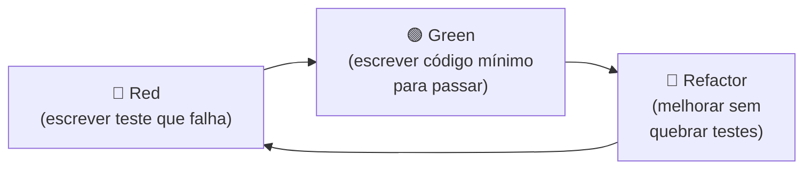
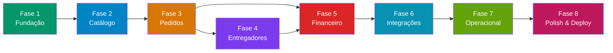

# BiteFlow — Plano de Desenvolvimento Faseado

> **Objetivo**: Dividir o desenvolvimento do backend em **8 fases incrementais**, cada uma executável em uma sessão de IA com limite de tokens. Cada fase é auto-contida, compilável e testável independentemente.
>
> **Metodologia**: Todas as fases seguem **TDD (Test-Driven Development)** — ciclo **🔴 Red → 🟢 Green → 🔵 Refactor**. Os testes são escritos **antes** do código de produção.

---

## Metodologia TDD Aplicada

### Ciclo por camada



### Tipos de teste por camada (Clean Architecture)

| Camada | Tipo de Teste | Ferramenta | Velocidade |
|--------|--------------|------------|------------|
| **Domain** | Unitário puro | JUnit 5 | ⚡ Instantâneo |
| **Application (Use Cases)** | Unitário com mocks | JUnit 5 + Mockito | ⚡ Rápido |
| **Infrastructure** | Integração com banco | `@QuarkusTest` + Dev Services | 🐢 Médio |
| **Presentation (REST)** | Integração HTTP | `@QuarkusTest` + REST Assured | 🐢 Médio |

> [!IMPORTANT]
> **Regra de ouro TDD**: Nenhum arquivo de produção é criado sem um teste que falha (🔴) antes. O código de produção mínimo é escrito apenas para fazer o teste passar (🟢). Só então se refatora (🔵).

---

## Visão Geral das Fases



| Fase | Nome | Entidades | Endpoints | Estimativa |
|------|------|-----------|-----------|------------|
| 1 | Fundação & Auth | Store, User | 8 | Base do projeto |
| 2 | Catálogo | Product, Ingredient, ModifierGroup, Additional | 22 | CRUD completo |
| 3 | Pedidos (Core) | Order, OrderItem, OrderItemModifier, OrderItemRemoval | 12 | Coração do sistema |
| 4 | Entregadores | DeliveryDriver, DeliverySettlement | 7 | CRUD + relatório |
| 5 | Financeiro & CMV | FinancialRecord, Dashboard | 8 | Relatórios e KPIs |
| 6 | Integrações | WhatsApp, iFood, Chat | 12 | APIs externas |
| 7 | Operacional & Público | Checklist, SupplierQuote, Review, DigitalMenu | 10 | Features complementares |
| 8 | Polish & Deploy | — | — | NF-e, testes, Docker, GCP |

---

## Fase 1 — Fundação & Autenticação

> **Pré-requisito**: Nenhum
> **Resultado**: Projeto Quarkus rodando com banco, auth JWT e CRUD de usuários

### Escopo

- Configurar dependências faltantes (Flyway, SmallRye JWT, Bean Validation, Security)
- Implementar a estrutura Clean Architecture (pacotes `domain`, `application`, `infrastructure`, `presentation`)
- Criar entidade `Store` e `User`
- Implementar autenticação JWT (login/logout/me)
- Implementar CRUD de Usuários com RBAC
- Criar `GlobalExceptionMapper` e `ErrorResponse`
- Configurar CORS, Flyway migration V1

### Entidades

| Entidade | Tabela | Campos-chave |
|----------|--------|-------------|
| `Store` | `store` | id, name, logoUrl, isOpen, openingHours, address |
| `User` | `users` | id, storeId, name, login, passwordHash, role, permissions[], active |

### Endpoints (8)

```
POST   /api/v1/auth/login
POST   /api/v1/auth/logout
GET    /api/v1/auth/me

GET    /api/v1/store
PUT    /api/v1/store

GET    /api/v1/users
POST   /api/v1/users
PUT    /api/v1/users/{id}
DELETE /api/v1/users/{id}
```

### Ordem TDD

**Passo 1 — Setup (sem testes, pré-condição estrutural)**
- Adicionar dependências no `pom.xml`
- Configurar `application.properties` (DB, JWT, CORS)
- Gerar chaves RSA (`privateKey.pem`, `publicKey.pem`)
- Criar migration `V1__foundation.sql`
- Remover arquivos de exemplo (`GreetingResource.java`, `MyEntity.java`)

**Passo 2 — 🔴🟢 Domain**
```
Testes unitários puros (JUnit 5, sem framework):
- UserTest          → criar User, validar role, permissões
- StoreTest         → criar Store, isOpen padrão false
- RoleTest          → enum ADMIN, GERENTE, CAIXA
- PermissionTest    → enum com todos os valores
```

**Passo 3 — 🔴🟢 Use Cases**
```
Testes unitários com Mockito (sem banco, sem HTTP):
- LoginUseCaseTest          → credenciais válidas/inválidas, JWT no response
- CreateUserUseCaseTest      → criar user, login duplicado, hash de senha
- UpdateUserUseCaseTest      → atualizar, not found
- DeleteUserUseCaseTest      → deletar, not found
- ListUsersUseCaseTest       → lista, lista vazia
- GetStoreInfoUseCaseTest    → dados da loja, not found
- UpdateStoreInfoUseCaseTest → atualizar loja, not found
```

**Passo 4 — 🔴🟢 Infrastructure**
```
Testes @QuarkusTest + Dev Services (PostgreSQL automático):
- PanacheUserRepositoryTest  → salvar, buscar por login, listar
- PanacheStoreRepositoryTest → salvar, recuperar
- JwtTokenProviderTest       → gerar token, verificar claims, expiração
- PasswordHasherTest         → hash, verificar senha correta/errada
```

**Passo 5 — 🔴🟢 Presentation**
```
Testes @QuarkusTest + REST Assured (HTTP real):
- AuthResourceTest  → login 200/401/400, /me 200/401, logout 204
- UserResourceTest  → CRUD completo, 401/403, validações 400
- StoreResourceTest → GET/PUT 200, roles corretos, 401/403
```

### Migration V1

```sql
-- V1__foundation.sql
CREATE TABLE store (...)
CREATE TABLE users (...)
```

### Entregáveis / Checklist TDD

- [ ] Setup: dependências, properties, chaves RSA, migration V1
- [ ] 🔴 Testes de domínio escritos e falhando
- [ ] 🟢 Domain entities passando nos testes
- [ ] 🔴 Testes de use cases escritos e falhando
- [ ] 🟢 Use cases passando nos testes
- [ ] 🔴 Testes de infra escritos e falhando
- [ ] 🟢 JPA entities + repositories passando nos testes
- [ ] 🟢 JwtTokenProvider e PasswordHasher passando nos testes
- [ ] 🔴 Testes REST escritos e falhando
- [ ] 🟢 Resources passando nos testes
- [ ] 🟢 GlobalExceptionMapper cobrindo todos os status HTTP
- [ ] `mvn test` — 100% dos testes passando
- [ ] `mvn quarkus:dev` — projeto sobe sem erros

### Prompt sugerido para a sessão

```
Implemente a Fase 1 do backend BiteFlow seguindo TDD (Red → Green → Refactor).
Specs: @[biteflow_api_backend_spec_v2.md] e @[biteflow_development_phases.md].

O projeto Quarkus 3.33 (Java 25) já existe com Panache, PostgreSQL e RESTEasy.
Pacote raiz: com.fidecode.biteflow. Remova GreetingResource.java e MyEntity.java.

Ordem obrigatória:
1. Setup (pom.xml, application.properties, chaves RSA, V1__foundation.sql)
2. 🔴 Escrever testes de domínio → 🟢 Implementar domain entities
3. 🔴 Escrever testes de use cases (Mockito) → 🟢 Implementar use cases + DTOs
4. 🔴 Escrever testes de infra (@QuarkusTest) → 🟢 Implementar JPA + security
5. 🔴 Escrever testes REST (REST Assured) → 🟢 Implementar resources + exception mappers

Gere testes ANTES do código de produção. O projeto deve passar em `mvn test`.
```

---

## Fase 2 — Catálogo (Produtos, Ingredientes, Modificadores)

> **Pré-requisito**: Fase 1 concluída
> **Resultado**: CRUD completo de produtos com ficha técnica, modificadores e adicionais

### Escopo

- Implementar `Ingredient` (CRUD completo + alerta de estoque mínimo)
- Implementar `Product` (CRUD completo + ficha técnica + itens removíveis + vínculo com modificadores)
- Implementar `ModifierGroup` + `ModifierOption` (CRUD de grupos de modificadores)
- Implementar `Additional` (CRUD + toggle status)
- Cálculo de custo do produto via ficha técnica (totalCost, profit)

### Entidades

| Entidade | Tabela | Campos-chave |
|----------|--------|-------------|
| `Ingredient` | `ingredient` | id, storeId, name, stock, unit, costPrice, minStock |
| `Product` | `product` | id, storeId, name, category, description, price, imageUrl, stock, active |
| `TechnicalSheetItem` | `technical_sheet_item` | id, productId, ingredientId, quantity, costSnapshot |
| `ProductRemovableItem` | `product_removable_item` | productId, ingredientId |
| `ProductModifierGroup` | `product_modifier_group` | productId, modifierGroupId |
| `ModifierGroup` | `modifier_group` | id, storeId, name, type, required, min/maxSelections, icon |
| `ModifierOption` | `modifier_option` | id, modifierGroupId, name, price, sortOrder |
| `Additional` | `additional` | id, storeId, name, price, category, active |

### Endpoints (22)

```
# Ingredientes (5)
GET    /api/v1/ingredients
GET    /api/v1/ingredients/{id}
POST   /api/v1/ingredients
PUT    /api/v1/ingredients/{id}
DELETE /api/v1/ingredients/{id}

# Produtos (8)
GET    /api/v1/products
GET    /api/v1/products/{id}
POST   /api/v1/products
PUT    /api/v1/products/{id}
DELETE /api/v1/products/{id}
PUT    /api/v1/products/{id}/removable-items
PUT    /api/v1/products/{id}/modifier-groups
GET    /api/v1/products/categories

# Modificadores (4)
GET    /api/v1/modifier-groups
POST   /api/v1/modifier-groups
PUT    /api/v1/modifier-groups/{id}
DELETE /api/v1/modifier-groups/{id}

# Adicionais (5)
GET    /api/v1/additionals
POST   /api/v1/additionals
PUT    /api/v1/additionals/{id}
PATCH  /api/v1/additionals/{id}/toggle-status
DELETE /api/v1/additionals/{id}
```

### Ordem TDD

**Passo 1 — 🔴🟢 Domain**
```
- IngredientTest         → criar ingredient, validar minStock, unidade
- ProductTest            → criar product, calcular totalCost (regra: sum(costPrice × qty))
- TechnicalSheetItemTest → snapshot de custo
- ModifierGroupTest      → tipo RADIO/CHECKBOX, validar min/max
- ModifierOptionTest     → preço pode ser zero
- AdditionalTest         → toggle active
```

**Passo 2 — 🔴🟢 Use Cases**
```
- CreateIngredientUseCaseTest    → criar, duplicado
- UpdateIngredientUseCaseTest    → atualizar, not found
- DeleteIngredientUseCaseTest    → deletar, not found
- ListIngredientsUseCaseTest     → lista, alerta de estoque baixo no response
- CreateProductUseCaseTest       → criar com ficha técnica, calcular totalCost/profit
- UpdateProductUseCaseTest       → atualizar, not found
- DeleteProductUseCaseTest       → deletar, not found
- ListProductsUseCaseTest        → filtrar por categoria
- CreateModifierGroupUseCaseTest → criar com options
- UpdateModifierGroupUseCaseTest → atualizar
- DeleteModifierGroupUseCaseTest → deletar
- CreateAdditionalUseCaseTest    → criar additional
- ToggleAdditionalStatusUseCaseTest → ativar/desativar
```

**Passo 3 — 🔴🟢 Infrastructure**
```
- PanacheIngredientRepositoryTest → CRUD, busca por storeId
- PanacheProductRepositoryTest    → CRUD, filtrar categoria, categories distinct
- PanacheModifierGroupRepositoryTest → CRUD
- PanacheAdditionalRepositoryTest → CRUD
```

**Passo 4 — 🔴🟢 Presentation**
```
- IngredientResourceTest → CRUD 200/201/204, 404, 400, 401/403
- ProductResourceTest    → CRUD, /removable-items, /modifier-groups, /categories, totalCost/profit no response
- ModifierGroupResourceTest → CRUD
- AdditionalResourceTest → CRUD + toggle-status
```

### Migration V2

```sql
-- V2__catalog.sql
CREATE TABLE ingredient (...)
CREATE TABLE product (...)
CREATE TABLE technical_sheet_item (...)
CREATE TABLE product_removable_item (...)
CREATE TABLE product_modifier_group (...)
CREATE TABLE modifier_group (...)
CREATE TABLE modifier_option (...)
CREATE TABLE additional (...)
```

### Entregáveis / Checklist TDD

- [ ] 🔴🟢 Testes e implementação de domínio (Ingredient, Product, ModifierGroup, Additional)
- [ ] 🔴🟢 Testes e implementação de use cases (CRUD de todos + cálculo totalCost/profit)
- [ ] 🔴🟢 Testes e implementação de infrastructure (repositories + migration V2)
- [ ] 🔴🟢 Testes e implementação de presentation (resources + 401/403/404/400)
- [ ] `mvn test` — 100% dos testes passando

### Prompt sugerido para a sessão

```
Implemente a Fase 2 do backend BiteFlow (Catálogo) seguindo TDD (Red → Green → Refactor).
Specs: @[biteflow_api_backend_spec_v2.md] e @[biteflow_development_phases.md].

Fase 1 já concluída (Auth, Store, User, Clean Architecture).

Ordem obrigatória por módulo (Ingredient, Product, ModifierGroup, Additional):
1. 🔴 Escrever testes de domínio → 🟢 Implementar entities
2. 🔴 Escrever testes de use cases (Mockito) → 🟢 Implementar use cases + DTOs
3. 🔴 Escrever testes de infra (@QuarkusTest) → 🟢 Implementar JPA entities + repositories
4. 🔴 Escrever testes REST (REST Assured) → 🟢 Implementar resources

Incluir: cálculo de totalCost/profit no ProductResponse, alerta de estoque mínimo,
Flyway V2 migration. Todos os 22 endpoints da spec seção 5.4 a 5.7.
O projeto deve passar em `mvn test`.
```

---

## Fase 3 — Pedidos (Core do Negócio)

> **Pré-requisito**: Fase 2 concluída (depende de Product, ModifierGroup)
> **Resultado**: Criação, edição, Kanban, drag & drop, atribuição de motoboy

### Escopo

- Implementar `Order` como Aggregate Root com `OrderItem`, `OrderItemModifier`, `OrderItemRemoval`
- Criar pedido via POS (com itens customizados, quantidade e observação)
- Editar pedido existente (adicionar itens)
- Kanban: listar pedidos agrupados por status (4 colunas)
- Avançar status / Mover pedido (drag & drop)
- Atribuir motoboy (individual e em massa)
- Validação: motoboy obrigatório para `EM_ROTA` em pedidos delivery
- Pedido balcão pode pular `EM_ROTA` → `FINALIZADO`
- Excluir pedido

### Entidades

| Entidade | Tabela | Campos-chave |
|----------|--------|-------------|
| `Order` | `orders` | id, storeId, displayId, customerId, customerName, customerAddress, type, status, paymentMethod, driverId, driverName, platform, externalOrderId, subtotal, deliveryCost, totalValue, nfeEmitted |
| `OrderItem` | `order_item` | id, orderId, productId, productName, quantity, unitPrice, extraPrice, totalPrice, observation |
| `OrderItemModifier` | `order_item_modifier` | id, orderItemId, modifierGroupId, groupName, modifierOptionId, optionName, price |
| `OrderItemRemoval` | `order_item_removal` | id, orderItemId, ingredientId, ingredientName |
| `Customer` | `customer` | id, storeId, name, phone, email, zipCode, address*, totalOrders |

### Endpoints (17)

```
# Pedidos (12)
GET    /api/v1/orders/kanban
GET    /api/v1/orders/{id}
POST   /api/v1/orders
PUT    /api/v1/orders/{id}
PATCH  /api/v1/orders/{id}/advance
PATCH  /api/v1/orders/{id}/move
PATCH  /api/v1/orders/{id}/assign-driver
POST   /api/v1/orders/{id}/nfe
PATCH  /api/v1/orders/batch/move
PATCH  /api/v1/orders/batch/assign-driver
DELETE /api/v1/orders/{id}

# Clientes (5)
GET    /api/v1/customers
GET    /api/v1/customers/{id}
POST   /api/v1/customers
PUT    /api/v1/customers/{id}
DELETE /api/v1/customers/{id}
```

### Ordem TDD

**Passo 1 — 🔴🟢 Domain**
```
- OrderTest               → criar order, calcular totalValue, snapshot de preços
- OrderItemTest           → calcular totalPrice = (unitPrice + extraPrice) × quantity
- OrderDomainServiceTest  → transições válidas (ANALISE→PREPARO→EM_ROTA→FINALIZADO)
                            motoboy obrigatório para EM_ROTA delivery
                            balcão pode pular EM_ROTA→FINALIZADO
                            CANCELADO é terminal (não avança)
- CustomerTest            → criar customer, incrementar totalOrders
```

**Passo 2 — 🔴🟢 Use Cases**
```
- CreateOrderUseCaseTest         → criar com itens, modifiers, removals
- UpdateOrderUseCaseTest         → adicionar itens a pedido existente, not found
- AdvanceOrderStatusUseCaseTest  → transição sequencial válida e inválida
- MoveOrderToColumnUseCaseTest   → mover para qualquer coluna (drag & drop)
- AssignDriverUseCaseTest        → individual e batch
- DeleteOrderUseCaseTest         → deletar pedido
- ListOrdersKanbanUseCaseTest    → agrupa por 4 colunas
- EmitNfeUseCaseTest             → stub: marcar nfeEmitted=true
- CustomerCRUDUseCaseTest        → CRUD completo
```

**Passo 3 — 🔴🟢 Infrastructure**
```
- PanacheOrderRepositoryTest    → salvar, buscar por status, buscar kanban
- PanacheCustomerRepositoryTest → CRUD, busca por phone/name
```

**Passo 4 — 🔴🟢 Presentation**
```
- OrderResourceTest    → kanban, CRUD, advance, move, assign-driver, batch, nfe stub
- CustomerResourceTest → CRUD, busca por search=
```

### Migration V3

```sql
-- V3__orders_and_customers.sql
CREATE TABLE customer (...)
CREATE TABLE orders (...)
CREATE TABLE order_item (...)
CREATE TABLE order_item_modifier (...)
CREATE TABLE order_item_removal (...)
```

### Entregáveis / Checklist TDD

- [ ] 🔴🟢 Domain: Order (aggregate root), OrderDomainService, Customer
- [ ] 🔴🟢 Use Cases: CRUD de pedidos, transições, kanban, batch, NF-e stub
- [ ] 🔴🟢 Infrastructure: repositories + migration V3
- [ ] 🔴🟢 Presentation: resources REST com todos os cenários de erro
- [ ] `mvn test` — 100% dos testes passando

### Prompt sugerido para a sessão

```
Implemente a Fase 3 do backend BiteFlow (Pedidos) seguindo TDD (Red → Green → Refactor).
Specs: @[biteflow_api_backend_spec_v2.md] e @[biteflow_development_phases.md].

Fases 1 e 2 já concluídas (Auth, Catálogo completo).

Ordem obrigatória:
1. 🔴 Domain: Order, OrderItem, OrderDomainService, Customer → 🟢 Implementar
2. 🔴 Use Cases (Mockito): CreateOrder, UpdateOrder, AdvanceStatus, Move, AssignDriver, Kanban → 🟢 Implementar
3. 🔴 Infrastructure (@QuarkusTest): PanacheOrderRepository, PanacheCustomerRepository → 🟢 Implementar
4. 🔴 Presentation (REST Assured): OrderResource, CustomerResource → 🟢 Implementar

Regras de negócio obrigatórias: motoboy obrigatório para EM_ROTA delivery,
balcão pula EM_ROTA→FINALIZADO, NF-e como stub (nfeEmitted=true).
Migration V3. Todos os 17 endpoints. `mvn test` deve passar.
```

---

## Fase 4 — Entregadores

> **Pré-requisito**: Fase 3 concluída (referenciado em Order.driverId)
> **Resultado**: CRUD de entregadores + relatório de acerto

### Escopo

- Implementar `DeliveryDriver` (CRUD completo com tipo Fixo/Diarista)
- Implementar relatório de acerto (`DeliverySettlement`) por período (diário/semanal/mensal)
- Regra: `total = (deliveries × feePerDelivery) + allowance`

### Entidades

| Entidade | Tabela |
|----------|--------|
| `DeliveryDriver` | `delivery_driver` |

### Endpoints (7)

```
# Entregadores (5)
GET    /api/v1/drivers
GET    /api/v1/drivers/{id}
POST   /api/v1/drivers
PUT    /api/v1/drivers/{id}
DELETE /api/v1/drivers/{id}

# Acerto (1)
GET    /api/v1/settlements?period=daily|weekly|monthly
```

### Ordem TDD

**Passo 1 — 🔴🟢 Domain**
```
- DeliveryDriverTest       → criar driver, tipo Fixo/Diarista, rating inicial
- DeliverySettlementTest   → calcular total = (deliveries × feePerDelivery) + allowance
                             validar os três períodos (daily, weekly, monthly)
```

**Passo 2 — 🔴🟢 Use Cases**
```
- CreateDriverUseCaseTest         → criar driver, dados obrigatórios
- UpdateDriverUseCaseTest         → atualizar, not found
- DeleteDriverUseCaseTest         → deletar, not found
- ListDriversUseCaseTest          → listar todos
- GetDriverUseCaseTest            → por ID, not found
- GetSettlementReportUseCaseTest  → calcular acerto por período
                                    filtrar pedidos finalizados do período
                                    fórmula total correta
```

**Passo 3 — 🔴🟢 Infrastructure**
```
- PanacheDeliveryDriverRepositoryTest → CRUD, busca por storeId
- settlement query: contar deliveries por driver no período
```

**Passo 4 — 🔴🟢 Presentation**
```
- DeliveryDriverResourceTest   → CRUD 200/201/204, 404, 401/403
- DeliverySettlementResourceTest → GET /settlements?period=daily/weekly/monthly
                                   período inválido → 400
```

### Migration V4

```sql
-- V4__delivery.sql
CREATE TABLE delivery_driver (...)
```

### Entregáveis / Checklist TDD

- [ ] 🔴🟢 Domain: DeliveryDriver, DeliverySettlement com cálculo de acerto
- [ ] 🔴🟢 Use Cases: CRUD + GetSettlementReportUseCase
- [ ] 🔴🟢 Infrastructure: repository + migration V4
- [ ] 🔴🟢 Presentation: resources REST completos
- [ ] `mvn test` — 100% dos testes passando

### Prompt sugerido

```
Implemente a Fase 4 do backend BiteFlow (Entregadores) seguindo TDD (Red → Green → Refactor).
Specs: @[biteflow_api_backend_spec_v2.md] e @[biteflow_development_phases.md].

Fases 1-3 concluídas. Escopo: CRUD DeliveryDriver (Fixo/Diarista, allowance,
fixedDeliveryValue, rating), relatório de acerto por período com cálculo
total = (deliveries × fee) + allowance.

Ordem: 🔴 testes → 🟢 implementação por camada (domain → use cases → infra → presentation).
Migration V4. Endpoints seções 5.9 e 5.10 da spec. `mvn test` deve passar.
```

---

## Fase 5 — Financeiro, CMV & Dashboard

> **Pré-requisito**: Fases 3 e 4 concluídas (depende de Order e Driver)
> **Resultado**: Relatórios financeiros, CMV e painel de KPIs

### Escopo

- Implementar `FinancialRecord` (gerado automaticamente ao finalizar pedido)
- Relatórios: faturamento bruto, vendas por produto, formas de pagamento
- CMV geral (fórmula manual) e por produto (via ficha técnica)
- Dashboard: consolidar KPIs (vendas, clientes, pedidos ativos, ticket médio)
- Criar evento `OrderFinalizedEvent` que dispara criação do FinancialRecord

### Entidades

| Entidade | Tabela |
|----------|--------|
| `FinancialRecord` | `financial_record` |
| `FinancialRecordProduct` | `financial_record_product` |

### Endpoints (8)

```
# Financeiro (4)
GET    /api/v1/financial/summary?period=...
GET    /api/v1/financial/sales-by-product?period=...
GET    /api/v1/financial/payment-methods?period=...
GET    /api/v1/financial/records?startDate=&endDate=

# CMV (2)
POST   /api/v1/cmv/general
GET    /api/v1/cmv/product/{productId}

# Dashboard (1)
GET    /api/v1/dashboard
```

### Ordem TDD

**Passo 1 — 🔴🟢 Domain**
```
- FinancialRecordTest      → criar a partir de Order finalizado, status correto
- OrderFinalizedEventTest  → evento contém orderId, totalValue, paymentMethod, produtos
- CmvFormulaTest           → CMV geral: estoque_inicial + compras - estoque_final
                             CMV produto: sum(costPrice × qty na ficha técnica)
```

**Passo 2 — 🔴🟢 Use Cases**
```
- CreateFinancialRecordOnOrderFinalizedTest → evento dispara criação do record
- GetSalesSummaryUseCaseTest        → totalRevenue, variação % vs período anterior
- GetSalesByProductUseCaseTest      → ranking de produtos por receita
- GetPaymentMethodsReportUseCaseTest → distribuição por forma de pagamento
- CalculateGeneralCmvUseCaseTest    → fórmula manual, validar inputs
- CalculateProductCmvUseCaseTest    → via ficha técnica do produto
- GetDashboardUseCaseTest           → KPIs: vendas dia, novos clientes, pedidos ativos, ticket médio
                                      pedidos recentes, equipe de entrega
```

**Passo 3 — 🔴🟢 Infrastructure**
```
- PanacheFinancialRecordRepositoryTest → salvar, buscar por período, por paymentMethod
- Event observer: quando Order status = FINALIZADO → criar FinancialRecord
```

**Passo 4 — 🔴🟢 Presentation**
```
- FinancialResourceTest → summary/sales-by-product/payment-methods/records
- CmvResourceTest       → general (POST), product/{id} (GET)
- DashboardResourceTest → GET /dashboard com todos os KPIs
```

### Migration V5

```sql
-- V5__financial.sql
CREATE TABLE financial_record (...)
CREATE TABLE financial_record_product (...)
```

### Entregáveis / Checklist TDD

- [ ] 🔴🟢 Domain: FinancialRecord, OrderFinalizedEvent, fórmulas CMV
- [ ] 🔴🟢 Use Cases: auto-geração, relatórios, CMV, Dashboard KPIs
- [ ] 🔴🟢 Infrastructure: repository + event observer + migration V5
- [ ] 🔴🟢 Presentation: resources REST completos
- [ ] `mvn test` — 100% dos testes passando

### Prompt sugerido

```
Implemente a Fase 5 do backend BiteFlow (Financeiro/CMV/Dashboard) seguindo TDD.
Specs: @[biteflow_api_backend_spec_v2.md] e @[biteflow_development_phases.md].

Fases 1-4 concluídas. Escopo: FinancialRecord (auto-gerado ao finalizar pedido via
OrderFinalizedEvent), relatórios financeiros (summary, sales-by-product, payment-methods),
CMV geral e por produto, Dashboard com KPIs.

Ordem: 🔴 testes → 🟢 implementação por camada (domain → use cases → infra → presentation).
Migration V5. Endpoints seções 5.11, 5.12 e 5.21 da spec. `mvn test` deve passar.
```

---

## Fase 6 — Integrações (WhatsApp, iFood, Chat)

> **Pré-requisito**: Fase 3 concluída (depende de Order para sincronizar status)
> **Resultado**: Endpoints de integração + chat drawer

### Escopo

- Implementar `WhatsAppSession`: connect (QR code), disconnect, status
- Implementar `IFoodConfig`: authorize (OAuth), toggle store, poll orders, sync status
- Implementar `ChatConversation` + `ChatMessage`: listar conversas, enviar mensagem
- Feature flag via `@IfBuildProperty` para habilitar/desabilitar integrações
- Polling de pedidos iFood como Scheduled job

### Entidades

| Entidade | Tabela |
|----------|--------|
| `WhatsAppSession` | `whatsapp_session` |
| `IFoodConfig` | `ifood_config` |
| `ChatConversation` | `chat_conversation` |
| `ChatMessage` | `chat_message` |

### Endpoints (12)

```
# WhatsApp (4)
GET    /api/v1/integrations/whatsapp/status
POST   /api/v1/integrations/whatsapp/connect
POST   /api/v1/integrations/whatsapp/disconnect
POST   /api/v1/integrations/whatsapp/send

# iFood (5)
GET    /api/v1/integrations/ifood/status
POST   /api/v1/integrations/ifood/authorize
POST   /api/v1/integrations/ifood/toggle-store
GET    /api/v1/integrations/ifood/new-orders
POST   /api/v1/integrations/ifood/orders/{externalOrderId}/status

# Chat (3)
GET    /api/v1/chats
GET    /api/v1/chats/{conversationId}
POST   /api/v1/chats/{conversationId}/messages
```

### Ordem TDD

**Passo 1 — 🔴🟢 Domain / Gateway Interfaces**
```
- WhatsAppSessionTest   → estados: DISCONNECTED, PENDING_QR, CONNECTED
- IFoodConfigTest       → estados OPEN/CLOSED da loja, status de conexão
- ChatConversationTest  → criar conversa, adicionar mensagem
- WhatsAppGateway       → interface (port): connect(), disconnect(), send()
- IFoodGateway          → interface (port): authorize(), toggleStore(), pollOrders(), syncStatus()
```

**Passo 2 — 🔴🟢 Use Cases (com stubs/mocks de gateway)**
```
- ConnectWhatsAppUseCaseTest      → chama gateway.connect(), persiste status
- DisconnectWhatsAppUseCaseTest   → chama gateway.disconnect()
- GetWhatsAppStatusUseCaseTest    → retorna status atual
- AuthorizeIFoodUseCaseTest       → salva credenciais (criptografadas), chama gateway
- ToggleIFoodStoreUseCaseTest     → OPEN→CLOSED e CLOSED→OPEN
- PollIFoodOrdersUseCaseTest      → converte pedidos externos em Order do domínio
- SyncIFoodStatusUseCaseTest      → sincroniza status ao mover pedido no kanban
- ListConversationsUseCaseTest    → listar com filtro de plataforma
- SendMessageUseCaseTest          → adicionar mensagem e chamar gateway
```

**Passo 3 — 🔴🟢 Infrastructure (stub implementations)**
```
- WhatsAppApiClientTest (stub) → implementa WhatsAppGateway com respostas fixas
- IFoodApiClientTest (stub)    → implementa IFoodGateway com respostas fixas
- PanacheChatRepositoryTest    → CRUD de conversas e mensagens
- IFoodSchedulerTest           → job de polling configurável por intervalo
```

**Passo 4 — 🔴🟢 Presentation**
```
- WhatsAppResourceTest → status/connect/disconnect/send
- IFoodResourceTest    → status/authorize/toggle-store/new-orders/sync-status
- ChatResourceTest     → listar conversas, mensagens, enviar
```

### Migration V6

```sql
-- V6__integrations.sql
CREATE TABLE whatsapp_session (...)
CREATE TABLE ifood_config (...)
CREATE TABLE chat_conversation (...)
CREATE TABLE chat_message (...)
```

### Entregáveis / Checklist TDD

- [ ] 🔴🟢 Domain: entities + gateway interfaces (ports)
- [ ] 🔴🟢 Use Cases: todos com mocks dos gateways
- [ ] 🔴🟢 Infrastructure: stubs + scheduled job + repositories + migration V6
- [ ] 🔴🟢 Presentation: resources REST com feature flags
- [ ] `mvn test` — 100% dos testes passando

### Prompt sugerido

```
Implemente a Fase 6 do backend BiteFlow (Integrações) seguindo TDD.
Specs: @[biteflow_api_backend_spec_v2.md] e @[biteflow_development_phases.md].

Fases 1-5 concluídas. Escopo: WhatsApp (connect/disconnect/status/send com gateway stub),
iFood (authorize/toggle-store/poll-orders/sync-status com gateway stub), Chat (conversas + mensagens).
Feature flags com @IfBuildProperty. Scheduled job para polling iFood.

Ordem: 🔴 testes → 🟢 implementação por camada (domain/gateways → use cases → infra stubs → presentation).
Migration V6. Endpoints seções 5.14, 5.15 e 5.16 da spec. `mvn test` deve passar.
```

---

## Fase 7 — Operacional & Rotas Públicas

> **Pré-requisito**: Fases 2 e 3 concluídas
> **Resultado**: Checklist, cotações, avaliação de pedidos e cardápio digital

### Escopo

- Implementar Checklist diário (abertura/fechamento) com templates e execuções
- Implementar Cotações de fornecedores (Supplier + SupplierQuote)
- Implementar Avaliação de Pedidos (OrderReview) — rota pública
- Implementar Cardápio Digital — rota pública (read-only do catálogo + criação de pedido)

### Entidades

| Entidade | Tabela |
|----------|--------|
| `ChecklistTemplate` | `checklist_template` |
| `ChecklistItem` | `checklist_item` |
| `ChecklistExecution` | `checklist_execution` |
| `Supplier` | `supplier` |
| `SupplierQuote` | `supplier_quote` |
| `OrderReview` | `order_review` |

### Endpoints (10)

```
# Checklist (2)
GET    /api/v1/checklists?type=ABERTURA|FECHAMENTO
POST   /api/v1/checklists/executions

# Cotações (3)
GET    /api/v1/quotes
POST   /api/v1/quotes
GET    /api/v1/quotes/ingredient/{ingredientId}/history

# Avaliação - PÚBLICO (2)
POST   /api/v1/reviews
GET    /api/v1/reviews/order/{orderId}

# Cardápio Digital - PÚBLICO (2)
GET    /api/v1/menu/{storeName}
POST   /api/v1/menu/{storeName}/orders
```

### Ordem TDD

**Passo 1 — 🔴🟢 Domain**
```
- ChecklistTemplateTest  → tipo ABERTURA/FECHAMENTO, lista de itens
- ChecklistExecutionTest → calcular progresso (itens concluídos / total)
- SupplierTest           → criar supplier
- SupplierQuoteTest      → criar cotação com preço e data
- OrderReviewTest        → ratings obrigatório: geral (≥1), demais opcionais
                           recalcular rating médio do entregador após submissão
```

**Passo 2 — 🔴🟢 Use Cases**
```
- GetChecklistUseCaseTest           → retornar template com progresso do dia
- SaveChecklistExecutionUseCaseTest → salvar itens concluídos
- ListQuotesUseCaseTest             → listar com filtro
- CreateQuoteUseCaseTest            → criar cotação
- GetQuoteHistoryUseCaseTest        → histórico por ingrediente
- SubmitOrderReviewUseCaseTest      → submeter avaliação, recalcular rating do driver
                                      rejeitar avaliação duplicada (ReviewAlreadyExistsException)
- GetOrderReviewUseCaseTest         → buscar por orderId
- GetDigitalMenuUseCaseTest         → produtos agrupados por categoria (rota pública)
- CreateOrderViaMenuUseCaseTest     → criar pedido sem autenticação
```

**Passo 3 — 🔴🟢 Infrastructure**
```
- PanacheChecklistRepositoryTest   → buscar template por tipo e storeId
- PanacheSupplierQuoteRepositoryTest → listar, histórico por ingrediente
- PanacheOrderReviewRepositoryTest   → salvar, buscar por orderId
```

**Passo 4 — 🔴🟢 Presentation**
```
- ChecklistResourceTest    → GET com progresso, POST execução
- QuoteResourceTest        → CRUD + histórico
- ReviewResourceTest       → POST/GET públicos (@PermitAll), duplicado 409
- DigitalMenuResourceTest  → GET cardápio público, POST pedido público (sem token)
```

### Migration V7

```sql
-- V7__operational_and_public.sql
CREATE TABLE checklist_template (...)
CREATE TABLE checklist_item (...)
CREATE TABLE checklist_execution (...)
CREATE TABLE supplier (...)
CREATE TABLE supplier_quote (...)
CREATE TABLE order_review (...)
```

### Entregáveis / Checklist TDD

- [ ] 🔴🟢 Domain: Checklist, SupplierQuote, OrderReview (com recálculo de rating)
- [ ] 🔴🟢 Use Cases: todos os fluxos incluindo rotas públicas
- [ ] 🔴🟢 Infrastructure: repositories + migration V7
- [ ] 🔴🟢 Presentation: resources protegidos + públicos (@PermitAll)
- [ ] `mvn test` — 100% dos testes passando

### Prompt sugerido

```
Implemente a Fase 7 do backend BiteFlow (Operacional & Público) seguindo TDD.
Specs: @[biteflow_api_backend_spec_v2.md] e @[biteflow_development_phases.md].

Fases 1-6 concluídas. Escopo: Checklist diário (templates + execuções + progresso),
Cotações (Supplier + SupplierQuote + histórico), Avaliação de pedidos (público,
recalcula rating do entregador, rejeita duplicata), Cardápio Digital (público,
read-only + criação de pedido sem auth).

Ordem: 🔴 testes → 🟢 implementação por camada (domain → use cases → infra → presentation).
Migration V7. Endpoints seções 5.13, 5.17, 5.18 e 5.20 da spec. `mvn test` deve passar.
```

---

## Fase 8 — Polish, Testes & Deploy

> **Pré-requisito**: Todas as fases anteriores concluídas
> **Resultado**: Projeto production-ready com testes, Docker e deploy GCP

### Escopo

- Integração real de NF-e (se aplicável) ou consolidar o stub
- Implementar paginação em listagens pesadas (clientes, pedidos finalizados, registros financeiros)
- Implementar `@CacheResult` em Dashboard e relatórios
- Adicionar Health Checks (liveness/readiness)
- Criar `Dockerfile` otimizado (multi-stage ou native build)
- Configurar OpenAPI/Swagger UI
- Escrever testes de integração end-to-end para os fluxos críticos
- Configurar `docker-compose.yml` (app + PostgreSQL)
- Documentar deploy para GCP Cloud Run + Cloud SQL

### Ordem TDD

**Testes de integração end-to-end (fluxos críticos)**
```
- OrderFlowIntegrationTest     → criar pedido → avançar → atribuir motoboy
                                 → finalizar → verificar FinancialRecord criado
                                 → verificar Dashboard atualizado
- AuthFlowIntegrationTest      → login → /me → refresh → logout → /me 401
- CatalogFlowIntegrationTest   → criar ingredient → criar product com ficha técnica
                                 → verificar totalCost/profit calculados
- PublicMenuFlowIntegrationTest → acessar cardápio público → criar pedido sem auth
                                  → avaliar pedido → verificar rating do driver
```

**Testes de performance (básico)**
```
- PaginationTest   → GET /customers?page=0&size=20 retorna envelope correto
- CacheTest        → GET /dashboard duas vezes, verificar que segunda resposta é cacheada
```

### Entregáveis / Checklist TDD

- [ ] 🔴🟢 Testes E2E: fluxo completo de pedido (criar → avançar → finalizar → financeiro)
- [ ] 🔴🟢 Testes E2E: fluxo de auth e cardápio público
- [ ] 🔴🟢 Paginação: `PageResponse<T>` em listagens grandes + testes
- [ ] Cache: `@CacheResult` em Dashboard e relatórios financeiros
- [ ] Health Checks: `quarkus-smallrye-health`
- [ ] OpenAPI: `quarkus-smallrye-openapi` com Swagger UI
- [ ] Dockerfile multi-stage (ou native via GraalVM)
- [ ] `docker-compose.yml` para dev local
- [ ] Seed data migration (V99__seed_data.sql) para demo
- [ ] README.md com instruções de setup local e deploy
- [ ] Deploy script para GCP Cloud Run
- [ ] `mvn test` — 100% dos testes passando (incluindo E2E)

### Prompt sugerido

```
Finalize o backend BiteFlow (Fase 8 - Polish & Deploy) seguindo TDD.
Specs: @[biteflow_api_backend_spec_v2.md] e @[biteflow_development_phases.md].

Todas as fases anteriores concluídas. Escopo:
1. 🔴🟢 Testes E2E (fluxo pedido completo, auth, catálogo, cardápio público)
2. 🔴🟢 Paginação com PageResponse<T> + testes
3. Cache @CacheResult em Dashboard e relatórios
4. Health Checks, Swagger UI, Dockerfile multi-stage, docker-compose.yml
5. Seed data (V99__seed_data.sql) e README com setup/deploy GCP Cloud Run

`mvn test` deve passar com 100% dos testes incluindo E2E.
```

---

## Dicas de Execução

> [!TIP]
> **Como usar este guia em cada sessão**:
> 1. Abra uma nova conversa
> 2. Referencie a spec (`@biteflow_api_backend_spec_v2.md`) e este plano (`@biteflow_development_phases.md`)
> 3. Copie o **prompt sugerido** da fase que deseja executar
> 4. O agente terá todo o contexto necessário e seguirá **TDD automaticamente**

> [!IMPORTANT]
> **Ordem obrigatória**: As fases **devem** ser executadas na sequência (1→2→3...) pois cada uma depende das anteriores. As únicas fases que podem ser paralelas são 4 e 6 (ambas dependem apenas da Fase 3).

> [!IMPORTANT]
> **TDD é inegociável**: O agente **nunca** deve criar um arquivo de produção sem um teste que falha primeiro. Se o usuário não pedir explicitamente, o agente deve seguir TDD por padrão neste projeto.

> [!WARNING]
> **Antes de cada sessão**: Faça commit do código da fase anterior e verifique se o projeto compila com `mvn compile` e os testes passam com `mvn test`. Isso garante que a próxima fase parte de uma base estável.
