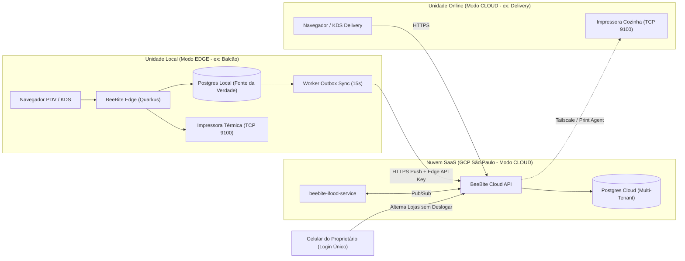

# Plano de Arquitetura, DevSecOps, FinOps e Implementação PRD — BeeBite SaaS (Opção A: Híbrida)

Este documento consolida a arquitetura de produção do **BeeBite** como um **SaaS Multi-Tenant e Multi-Loja 100% genérico** (atendendo desde clientes com 1 único CNPJ até grupos com 2 ou mais CNPJs/modalidades, como o caso de estreia do *Chefs Burguer*), os **5 bloqueadores de DevSecOps já resolvidos no código**, e a **Especificação Técnica de Implementação (Seção 8)** da **Opção A (Híbrida: Cloud + Edge Local com Outbox)**.

---

## 1. Modelo SaaS Multi-Loja Genérico (1 Login Único, Sem Deslogar)

No BeeBite, cada CNPJ/unidade operacional é um registro isolado na tabela `store` (estoque, cozinha, impressoras e caixa próprios). Porém, um mesmo proprietário (ou gerente geral) pode ser dono de **1, 2 ou N lojas**.

### Como funciona para qualquer cliente do SaaS (Genérico)

Em vez de amarrar o usuário a apenas uma loja fixa ([User.java](file:///d:/fideCod%20Solucoes/projetos/biteflow/beebite-backend/src/main/java/com/trinusphere/beebite/domain/auth/entity/User.java#L10-L29)), introduzimos a tabela associativa **`user_store_access`**:

| Perfil de Cliente no BeeBite | Comportamento no Login (`POST /api/v1/auth/login`) | Experiência na Interface (PC e Celular) |
|---|---|---|
| **Cliente com 1 única loja (1 CNPJ)** | Retorna `accessibleStores` com **1 loja** e já emite o cookie `biteflow_jwt` nela. | **Transparente:** como `accessibleStores.length === 1`, o seletor de lojas **não é exibido**. A tela fica limpa como loja única. |
| **Cliente com 2+ lojas/CNPJs** *(ex: 1 CNPJ Delivery + 1 CNPJ Balcão, ou Matriz + Filiais)* | Retorna `accessibleStores` com todas as lojas às quais o login tem acesso. | **Troca em 1 clique sem deslogar:** exibe o **Store Switcher** no topo. Ao tocar em outra unidade, chama `POST /api/v1/auth/switch-store/{storeId}`, que atualiza o cookie `biteflow_jwt` na hora sem pedir senha. |
| **Funcionário de 1 unidade específica** *(ex: Caixa do Balcão)* | Retorna `accessibleStores` apenas com a unidade onde ele trabalha. | Entra direto na unidade dele e não enxerga nem acessa as demais lojas do grupo. |

---

## 2. Arquitetura Híbrida (Opção A): Edge Local + Sincronização Outbox

Para qualquer unidade física que não possa depender de internet para vender no balcão (`BITEFLOW_SYNC_MODE=EDGE`), o BeeBite opera localmente e sincroniza de forma assíncrona com a Nuvem (`BITEFLOW_SYNC_MODE=CLOUD`):



1. **Single-Writer por Loja (Sem Conflito *Split-Brain*)**:
   - Na unidade configurada como `EDGE`, o banco PostgreSQL local é o único dono da escrita operacional daquele `store_id` (pedidos, caixa, KDS e baixas em `stock_movement`).
   - Todas as entidades já utilizam `UUID` como chave primária, garantindo idempotência ao sincronizar com a nuvem.
2. **Fila Transacional (`edge_sync_outbox`)**:
   - Na mesma transação que grava pedido, movimentação de estoque ou sessão de caixa na loja `EDGE`, um evento JSON é gravado na tabela `edge_sync_outbox`.
   - Um scheduler `@Scheduled(every = "15s")` envia os eventos pendentes via HTTPS (`POST /api/v1/internal/edge-sync`) usando o header `X-Edge-Device-Token` exclusivo daquela `store_id`.
3. **Visão no Celular do Dono**:
   - O proprietário acessa a Nuvem pelo celular com seu login único, alterna entre as lojas sem deslogar e visualiza o status de sincronização de cada unidade `EDGE` (`🟢 Online — Sincronizado há 15s` ou `🟡 Loja operando offline há 10 min`).

---

## 3. Atualização Remota do Servidor Local sem Ir ao Cliente (OTA DevSecOps)

| Componente | Papel na Máquina Local | Como Funciona |
|---|---|---|
| **Docker + GHCR / Artifact Registry** | Empacota `beebite-backend` + `beebite-front` em imagens versionadas (`v1.2.0`) | O GitHub Actions compila e publica a imagem automaticamente na nuvem a cada release. |
| **Watchtower (Janela 04:00h)** | Atualiza puxando de dentro para fora (*Pull-based*) | Configurado com cron `0 0 4 * * *` (madrugada). Faz `pg_dump` preventivo, baixa a imagem nova, aplica migrations Flyway retrocompatíveis e reinicia fora do expediente. |
| **Tailscale (VPN Mesh WireGuard)** | Rede privada ponto-a-ponto criptografada | Atravessa CGNAT/roteadores sem abrir portas. Permite SSH remoto (`100.x.y.z`) para suporte e diagnóstico. |

---

## 4. Mitigação dos 6 Riscos de Campo (Hardware, Impressão e Segurança)

1. **Servidor Local Dedicado**: Rodar o Docker em um **Mini-PC dedicado (Intel N100, 8 GB RAM, SSD NVMe + Ubuntu Server LTS + Nobreak)** em vez do Windows compartilhado do caixa. O computador do caixa acessa apenas via navegador na LAN (`http://192.168.1.10`).
2. **Backup Offsite Criptografado**: Cronjob horário (`pg_dump` + `rclone`/`restic`) enviando backups para **Cloudflare R2** ou **GCS** (`< R\$ 1,00/mês`).
3. **Proteção de Propriedade Intelectual e Credenciais**:
   - Compilação **GraalVM Native Image** (`-Pnative` em [pom.xml](file:///d:/fideCod%20Solucoes/projetos/biteflow/beebite-backend/pom.xml#L201-L213)) para ocultar bytecode e reduzir RAM para ~60 MB.
   - A máquina local não possui credenciais do banco da nuvem — apenas um `edge_sync_token` revogável restrito ao seu `store_id`.
4. **Sincronismo de Relógio (NTP) e Prefixo de Pedidos**: `chrony` ativo no Linux e suporte a prefixo de exibição por loja (`display_id`).
5. **Pagamentos POS e Contingência Fiscal**: Maquininhas com chip 4G próprio + Contingência Offline NFC-e quando sem internet.
6. **Impressão Térmica na Unidade Cloud (Delivery)**: Como [TcpPrinterGateway.java](file:///d:/fideCod%20Solucoes/projetos/biteflow/beebite-backend/src/main/java/com/trinusphere/beebite/infrastructure/printing/TcpPrinterGateway.java#L27-L33) conecta via TCP na porta `9100`, a unidade que roda 100% na nuvem utiliza **Tailscale Subnet Router** (ou agente local de impressão) para alcançar a impressora térmica na LAN da cozinha.

---

## 5. Decisão Consolidada de Arquitetura

- ✅ **Opção A Definida (Híbrida desde o Dia 1)**: Suporte nativo no BeeBite para unidades `CLOUD` (100% Nuvem com iFood) e unidades `EDGE` (Servidor Local Offline-First com `Transactional Outbox` sincronizando para a Nuvem), unificadas sob o mesmo login do proprietário via `Store Switcher`.

---

## 6. Estratégia FinOps: Google Cloud (`southamerica-east1`) + Cloudflare

| Camada | Estágio 1: de 1 a ~15 Lojas (Foco em Margem) | Estágio 2: de 15 a 100+ Lojas (Escala HA) |
|---|---|---|
| **Frontend (`beebite-front`)** | **Cloudflare Pages** (SPA estático, CDN, WAF, SSL grátis) → **R\$ 0/mês** | **Cloudflare Pages** → **R\$ 0/mês** |
| **Mensageria iFood** | **Google Cloud Pub/Sub** (10 GB Free Tier) → **R\$ 0/mês** | **Google Cloud Pub/Sub** → **~R\$ 0 a R\$ 25/mês** |
| **Compute + Proxy TLS** | **1 VM GCP Compute Engine** (`e2-small` Native ou `e2-medium` JVM) em SP + **Caddy** | **GKE Autopilot** ou **Cloud Run** |
| **Banco de Dados** | **1 único container PostgreSQL 17** com **2 databases lógicos** (`biteflow` e `beebite_ifood`) | **Cloud SQL PostgreSQL** (HA) ou **Neon / Supabase** em SP |
| **Backups + Imagens Cardápio** | **Cloudflare R2** (10 GB grátis, zero egress) → **R\$ 0 a R\$ 2/mês** | **Cloudflare R2 / GCS** → **~R\$ 15/mês** |
| **Custo Mensal Total** | **~US\$ 16 a US\$ 28/mês (~R\$ 95 a R\$ 165/mês)** | **~US\$ 110 a US\$ 180/mês** |

---

## 7. Auditoria DevSecOps: 5 Bloqueadores Pré-PRD — ✅ TODOS RESOLVIDOS (5/5)

Todos os 5 bloqueadores foram corrigidos e validados por testes ([ProductionSecurityBlockersTest.java](file:///d:/fideCod%20Solucoes/projetos/biteflow/beebite-backend/src/test/java/com/trinusphere/beebite/infrastructure/security/ProductionSecurityBlockersTest.java) e [ProductionSecurityIfoodBlockersTest.java](file:///d:/fideCod%20Solucoes/projetos/biteflow/beebite-ifood-service/src/test/java/com/trinusphere/beebiteifood/infrastructure/ProductionSecurityIfoodBlockersTest.java)):

1. **✅ Bloqueador #1 (Chaves RSA fora de `META-INF/resources/`)**: Movidas para `src/main/resources/jwt/` e parametrizadas em [application.properties](file:///d:/fideCod%20Solucoes/projetos/biteflow/beebite-backend/src/main/resources/application.properties#L20-L22).
2. **✅ Bloqueador #2 (Pub/Sub parametrizado para GCP Real e Modo Edge)**: Atualizados [IfoodOrderSubscriber.java](file:///d:/fideCod%20Solucoes/projetos/biteflow/beebite-backend/src/main/java/com/trinusphere/beebite/infrastructure/messaging/IfoodOrderSubscriber.java#L68-L120), publishers e subscribers para usar `quarkus.google.cloud.project-id` e desligar quando `biteflow.feature.ifood-integration.enabled=false`.
3. **✅ Bloqueador #3 (Cookie `biteflow_jwt` com `Secure` e `SameSite=Lax`)**: Parametrizado em [AuthResource.java](file:///d:/fideCod%20Solucoes/projetos/biteflow/beebite-backend/src/main/java/com/trinusphere/beebite/presentation/rest/AuthResource.java#L29-L63).
4. **✅ Bloqueador #4 (`ProductionAdminSeedGuard`, validação AES e `.gitignore`)**: Criados [ProductionAdminSeedGuard.java](file:///d:/fideCod%20Solucoes/projetos/biteflow/beebite-backend/src/main/java/com/trinusphere/beebite/infrastructure/security/ProductionAdminSeedGuard.java), validação de chave em [AesSecretEncryptor.java](file:///d:/fideCod%20Solucoes/projetos/biteflow/beebite-ifood-service/src/main/java/com/trinusphere/beebiteifood/infrastructure/crypto/AesSecretEncryptor.java#L37-L50) e [.gitignore](file:///d:/fideCod%20Solucoes/projetos/biteflow/.gitignore).
5. **✅ Bloqueador #5 (`LocalImageStorage` persistente e anti-SSRF)**: Parametrizado em [LocalImageStorage.java](file:///d:/fideCod%20Solucoes/projetos/biteflow/beebite-ifood-service/src/main/java/com/trinusphere/beebiteifood/infrastructure/storage/LocalImageStorage.java#L22-L87).

---

## 8. Especificação Técnica de Implementação (Multi-Store Switcher + Edge Outbox Sync)

Abaixo está o plano detalhado por camada (seguindo Clean Architecture e TDD) para implementar o **Acesso Multi-Loja sem Deslogar** e a **Sincronização Híbrida Edge → Cloud**.

### 8.1. Infraestrutura Existente Reutilizada

| Arquivo | O que faz e como será reutilizado |
|---|---|
| [Store.java](file:///d:/fideCod%20Solucoes/projetos/biteflow/beebite-backend/src/main/java/com/trinusphere/beebite/domain/store/entity/Store.java) | Entidade de domínio da loja; receberá metadados opcionais de sincronização (`syncMode`, `lastEdgeSyncAt`). |
| [User.java](file:///d:/fideCod%20Solucoes/projetos/biteflow/beebite-backend/src/main/java/com/trinusphere/beebite/domain/auth/entity/User.java) | Entidade de usuário; mantém `storeId` como loja padrão e ganha acesso a múltiplas lojas via `UserStoreAccess`. |
| [JwtTokenProvider.java](file:///d:/fideCod%20Solucoes/projetos/biteflow/beebite-backend/src/main/java/com/trinusphere/beebite/infrastructure/security/JwtTokenProvider.java) | Gerador RS256 do JWT; ganhará sobrecarga `generateTokenForStore(User user, UUID targetStoreId, Role role, List<Permission> permissions)` para o `SwitchStoreUseCase`. |
| [AuthResource.java](file:///d:/fideCod%20Solucoes/projetos/biteflow/beebite-backend/src/main/java/com/trinusphere/beebite/presentation/rest/AuthResource.java) | Resource de autenticação; receberá `POST /api/v1/auth/switch-store/{storeId}` e `GET /api/v1/auth/stores`. |
| [BaseResource.java](file:///d:/fideCod%20Solucoes/projetos/biteflow/beebite-backend/src/main/java/com/trinusphere/beebite/presentation/rest/BaseResource.java) | Continua extraindo `getStoreId()` do cookie JWT atual — **zero impacto nos Resources existentes** após a troca de loja! |

---

### 8.2. Migration SQL Completa (`V17__multi_store_and_edge_outbox.sql`)

```sql
-- ═══════════════════════════════════════════════════════════════════════════
-- V17__multi_store_and_edge_outbox.sql
-- 1. Acesso Multi-Loja Genérico (User <-> N Stores sem deslogar)
-- 2. Sincronização Híbrida Edge -> Cloud (Transactional Outbox + Idempotência)
-- ═══════════════════════════════════════════════════════════════════════════

-- ── 1. Vínculo N:N Usuário <-> Lojas (Multi-Store Access) ─────────────────
CREATE TABLE user_store_access (
    id          UUID        PRIMARY KEY DEFAULT gen_random_uuid(),
    user_id     UUID        NOT NULL REFERENCES users(id) ON DELETE CASCADE,
    store_id    UUID        NOT NULL REFERENCES store(id) ON DELETE CASCADE,
    role        VARCHAR(20) NOT NULL CHECK (role IN ('ADMIN','GERENTE','CAIXA')),
    permissions TEXT[]      NOT NULL DEFAULT '{}',
    created_at  TIMESTAMP   NOT NULL DEFAULT now(),
    CONSTRAINT uq_user_store_access UNIQUE (user_id, store_id)
);

CREATE INDEX idx_user_store_access_user ON user_store_access(user_id);
CREATE INDEX idx_user_store_access_store ON user_store_access(store_id);

-- Backfill automático: garante que todo usuário existente já tenha acesso à sua store_id original
INSERT INTO user_store_access (user_id, store_id, role, permissions)
SELECT id, store_id, role, permissions FROM users
ON CONFLICT (user_id, store_id) DO NOTHING;

-- ── 2. Configuração Edge na tabela Store ──────────────────────────────────
ALTER TABLE store
    ADD COLUMN IF NOT EXISTS sync_mode VARCHAR(20) NOT NULL DEFAULT 'CLOUD'
        CHECK (sync_mode IN ('CLOUD', 'EDGE')),
    ADD COLUMN IF NOT EXISTS edge_api_key_hash VARCHAR(255),
    ADD COLUMN IF NOT EXISTS last_edge_sync_at TIMESTAMP;

-- ── 3. Fila Local de Saída (Transactional Outbox no Nó Edge) ──────────────
CREATE TABLE edge_sync_outbox (
    id              UUID         PRIMARY KEY DEFAULT gen_random_uuid(),
    store_id        UUID         NOT NULL REFERENCES store(id) ON DELETE CASCADE,
    event_type      VARCHAR(60)  NOT NULL, -- 'ORDER_UPSERT', 'CASH_SESSION_UPSERT', 'STOCK_MOVEMENT_CREATED'
    aggregate_id    UUID         NOT NULL,
    payload         JSONB        NOT NULL,
    status          VARCHAR(20)  NOT NULL DEFAULT 'PENDING'
        CHECK (status IN ('PENDING', 'SYNCED', 'FAILED')),
    attempts        INTEGER      NOT NULL DEFAULT 0,
    last_error      TEXT,
    created_at      TIMESTAMP    NOT NULL DEFAULT now(),
    synced_at       TIMESTAMP
);

CREATE INDEX idx_edge_outbox_pending
    ON edge_sync_outbox(status, created_at ASC)
    WHERE status = 'PENDING';

-- ── 4. Controle de Idempotência na Nuvem (Evita aplicar 2x o mesmo evento) ─
CREATE TABLE edge_synced_event_log (
    event_id        UUID         PRIMARY KEY,
    store_id        UUID         NOT NULL REFERENCES store(id) ON DELETE CASCADE,
    event_type      VARCHAR(60)  NOT NULL,
    aggregate_id    UUID         NOT NULL,
    received_at     TIMESTAMP    NOT NULL DEFAULT now()
);

CREATE INDEX idx_edge_synced_log_store ON edge_synced_event_log(store_id, received_at DESC);
```

---

### 8.3. Detalhamento por Camada

#### Sub-fase 8A — Multi-Store Access & Store Switcher (Sem Deslogar)
> *"Como proprietário de 2 ou mais lojas (ou filiais), quero alternar entre minhas unidades em 1 clique no celular sem precisar deslogar, enquanto clientes de 1 única loja continuam com a interface simples."*

- **Domain (`domain/auth/`)**:
  - `[NEW]` `UserStoreAccess.java` (entidade pura: `id`, `userId`, `storeId`, `storeName`, `role`, `permissions`).
  - `[NEW]` `UserStoreAccessRepository.java` (port):
    ```java
    public interface UserStoreAccessRepository {
        List<UserStoreAccess> findByUserId(UUID userId);
        Optional<UserStoreAccess> findByUserAndStore(UUID userId, UUID storeId);
        UserStoreAccess save(UserStoreAccess access);
    }
    ```
- **Application Ports & DTOs (`application/auth/`)**:
  - `[MODIFY]` `TokenProvider.java`:
    ```java
    String generateToken(User user);
    String generateTokenForStore(User user, UUID targetStoreId, Role role, List<Permission> permissions);
    ```
  - `[NEW]` `AccessibleStoreResponse.java`:
    ```java
    public record AccessibleStoreResponse(
        String storeId,
        String storeName,
        String role,
        List<String> permissions,
        String syncMode,
        Instant lastEdgeSyncAt,
        boolean activeContext
    ) {}
    ```
  - `[MODIFY]` `LoginResponse.java`: inclui `List<AccessibleStoreResponse> accessibleStores` (retrocompatível).
- **Application Use Cases (`application/auth/`)**:
  - `[NEW]` `SwitchStoreUseCase.java`:
    1. Recebe `userId` (do JWT atual) e `targetStoreId`.
    2. Busca `User` ativo em `userRepository.findById(userId)`.
    3. Verifica permissão na loja destino via `userStoreAccessRepository.findByUserAndStore(userId, targetStoreId)` (lança `ForbiddenAccessException` 403 se o usuário não tiver vínculo com aquela loja).
    4. Gera novo JWT com `tokenProvider.generateTokenForStore(user, targetStoreId, access.getRole(), access.getPermissions())`.
    5. Retorna `LoginResponse` atualizado com o novo token e `accessibleStores`.
  - `[NEW]` `ListAccessibleStoresUseCase.java`: retorna todas as lojas vinculadas ao `userId` autenticado + status `lastEdgeSyncAt`.
  - `[NEW]` `GrantUserStoreAccessUseCase.java`: permite ao `ADMIN` vincular um usuário existente a uma segunda loja (`storeId`).
- **Presentation (`presentation/rest/AuthResource.java`)**:
  ```
  GET    /api/v1/auth/stores                   → ListAccessibleStoresUseCase
  POST   /api/v1/auth/switch-store/{storeId}   → SwitchStoreUseCase (atualiza Cookie biteflow_jwt em 1 clique)
  ```

---

#### Sub-fase 8B — Sincronização Híbrida Edge → Cloud (`Transactional Outbox`)
> *"Quando a loja de Balcão estiver sem internet, quero que o PDV continue vendendo e imprimindo localmente em < 2ms, e assim que a internet voltar, sincronize vendas, caixa e estoque para a nuvem automaticamente."*

- **Domain (`domain/sync/`)**:
  - `[NEW]` `EdgeOutboxEvent.java` (`id`, `storeId`, `eventType`, `aggregateId`, `payloadJson`, `status`, `attempts`, `createdAt`).
  - `[NEW]` `EdgeOutboxRepository.java`:
    ```java
    public interface EdgeOutboxRepository {
        EdgeOutboxEvent save(EdgeOutboxEvent event);
        List<EdgeOutboxEvent> findPendingBatch(int limit);
        void markSynced(List<UUID> eventIds, Instant syncedAt);
        void markFailed(UUID eventId, String errorMessage);
        boolean isEventAlreadyProcessed(UUID eventId);
        void recordProcessedEvent(UUID eventId, UUID storeId, String eventType, UUID aggregateId);
    }
    ```
- **Application DTOs & Ports (`application/sync/`)**:
  - `[NEW]` `EdgeSyncBatchRequest.java` & `EdgeSyncEventDto.java`:
    ```java
    public record EdgeSyncEventDto(
        UUID eventId,
        String eventType,
        UUID aggregateId,
        String payloadJson,
        Instant occurredAt
    ) {}

    public record EdgeSyncBatchRequest(
        UUID storeId,
        List<EdgeSyncEventDto> events
    ) {}

    public record EdgeSyncBatchResponse(
        int processedCount,
        List<UUID> ackedEventIds,
        Instant serverTimestamp
    ) {}
    ```
  - `[NEW]` `EdgeCloudSyncClient.java` (port para envio HTTP do Edge para a Cloud).
- **Application Use Cases (`application/sync/`)**:
  - `[NEW]` `EnqueueEdgeOutboxUseCase.java`: se a instância estiver em `BITEFLOW_SYNC_MODE=EDGE`, grava o snapshot na tabela `edge_sync_outbox` dentro da mesma transação de criação/atualização do pedido, movimento de estoque ou sessão de caixa.
  - `[NEW]` `FlushEdgeOutboxUseCase.java`: busca até 50 eventos `PENDING`, envia para a Nuvem via `EdgeCloudSyncClient` e marca os `ackedEventIds` como `SYNCED`.
  - `[NEW]` `IngestEdgeSyncBatchUseCase.java` (executado na Nuvem):
    1. Valida o `X-Edge-Device-Token` contra o `edge_api_key_hash` da `Store` informada.
    2. Para cada evento do lote, verifica `isEventAlreadyProcessed(event.eventId())` (idempotência).
    3. Aplica o snapshot de Pedido/Caixa/Estoque no banco da Nuvem, grava em `edge_synced_event_log` e atualiza `store.last_edge_sync_at = now()`.
- **Presentation (`presentation/rest/EdgeSyncResource.java` extends `BaseResource`)**:
  ```
  POST   /api/v1/internal/edge-sync   → IngestEdgeSyncBatchUseCase
         Header: X-Edge-Device-Token: <token-da-loja>
         Body: EdgeSyncBatchRequest
  ```

---

### 8.4. Ordem de Implementação (TDD) e Estimativa

| Passo | Camada | Descrição | Estimativa |
|---|---|---|---|
| **1** | 🔴🟢 Database & Domain | Migration `V17__multi_store_and_edge_outbox.sql` + testes unitários de `UserStoreAccess` e `EdgeOutboxEvent` | 0,5 dia |
| **2** | 🔴🟢 Application (Multi-Store) | Testes + implementação de `SwitchStoreUseCase`, `ListAccessibleStoresUseCase` e atualização do `LoginUseCase` | 1,0 dia |
| **3** | 🔴🟢 Infra & Presentation (Multi-Store) | `PanacheUserStoreAccessRepository`, endpoints `/auth/switch-store/{storeId}` e `/auth/stores` + seletor adaptativo no `beebite-front` | 1,0 dia |
| **4** | 🔴🟢 Application & Infra (Edge Outbox) | `EnqueueEdgeOutboxUseCase`, `FlushEdgeOutboxUseCase`, `IngestEdgeSyncBatchUseCase` e `EdgeSyncResource` | 1,5 dias |
| **5** | 🔵 DevSecOps & Deploy | `docker-compose.cloud.yml` (GCP SP + Caddy) e `docker-compose.edge.yml` (Mini-PC Balcão + Watchtower 04:00h) | 1,0 dia |

### 8.5. Verification Plan

```bash
# 1. Testes unitários de Segurança, Multi-Store e Edge Outbox
./mvnw test-compile surefire:test -Dtest="ProductionSecurityBlockersTest,SwitchStoreUseCaseTest,EdgeOutboxSyncUseCaseTest"

# 2. Gate obrigatório de Arquitetura (17 regras ArchUnit)
./mvnw surefire:test -Dtest="com.trinusphere.biteflow.architecture.CleanArchitectureTest"
```
